# Is That Line Real? Calibrated Tests for Informal Urban Divides

Nov 13, 2026 · @Prasad

Prasad Cheema, National Institute of Informatics (NII), Tokyo · in the group of [Mahito Sugiyama](https://www-nc.nii.ac.jp/en/faculty/informatics/sugiyama_mahito/), Principles of Informatics Research Division, NII

*This is the long master version. It splits into two submissions: the methods paper for GIScience 2027 (Sections 1–8, the test parts of 10.7 and 10.8, Figures 3–4, Appendix A) and a findings paper for CUPUM 2027 (Sections 9.5, 10 and the Latte Line), drafted separately as [The Latte Line on trial](https://claude.ai/artifact/K3uoSfau6w13mXT6JyijzV).*

## Abstract

Sydney's Latte Line, the divide between a café north-east and a fast-food south-west, began as a joke. It now has a Wikipedia article full of claims about money, schools, housing and the 2021 lockdowns. Lines like it are easy to draw on a census map and hard to test, because almost any smooth map splits into two tidy halves.

We show that the standard test for this, Moran spectral randomisation (MSR), calls smooth random maps "lines" far too often: 6% to 100% of the time on simulated landscapes, and 26–66% on the shapes of new cities, against a target of 5%. We replace it with a random-landscape test. Random cities are drawn just as smooth as the real one, in real space, averaged over the real areas, replayed from the records when the map comes from counts, and the p-value is calibrated by a double bootstrap.

We then use the test in four ways.

- **29 cities, with held-out replication.** We found lines in 18 cities in Australia, Japan and England, wrote down 58 predictions, and only then opened 11 new cities in the US, New Zealand and Singapore. The test kept its size there (5 false alarms in 72 Chicago maps with no line). Few lines are real (4% and 7% of those tested), almost none has a sharp edge, and most lines that looked general did not replicate. The Latte Line held up: cafés and fast food sort apart in all 29 cities, and the line is real when pooled over the held-out cities (p = 0.02, with the pooling checked against maps that have no line and corrected across every line pooled). That result came from pooling, not from a written prediction, so we took it to new countries: it holds in southern Europe (pooled over ten cities, p = 0.004, carried by Barcelona, Paris, Marseille and Rome) but not in nine Dutch, Swedish and Danish cities (p = 0.78) or in Canada.
- **The Latte Line on trial.** Of 11 claims from Wikipedia and the press, three hold, seven hold in part and one fails. The strongest: the 2021 lockdown's councils of concern lay on the line's fast-food side (p = 0.005, and 0.03 after correcting across the claims, on the exact council boundaries), though a jobs line matches them at least as well. The Delta wave's confirmed cases followed the line too: 22 per 1,000 residents on the fast-food side against 7 on the café side (Spearman ρ = −0.63 between case rate and the line, p = 0.003 against random Sydneys), and the jobs line predicts them better still (ρ = 0.74). That the line runs north-east against south-west through Parramatta is likely but not proven once we correct (p = 0.03 alone, 0.08 corrected). Money falls the same way but as a slope, and the divide did not harden between 2001 and 2021.
- **Countries and slopes.** Some lines exist only at country level: the Factory Line is real across Australia (p = 0.008 after correction) although none of Melbourne, Brisbane, Perth or Adelaide shows it alone. Money, apparent "grammars" of neighbouring areas and most divides turn out to be broad gradients. Even a step of three standard deviations across a border is detected only 17–54% of the time, so a gentle slope is not proof that no line exists.
- **Change over time and new countries.** Following 21 cities through their censuses (the US since 1990, Italy since 1991, Germany, the Netherlands, Sweden and São Paulo), older residents are moving outward in 18, while where people rent or live alone barely moves: lines tied to housing stay put, the age line is a moving front. A city's closest sister, by how its neighbourhoods sort, is in the same country 59% of the time (p = 0.001). The one cultural border tested, poutine across the Ottawa River, is unmistakable (7.7% of fast food in Gatineau against 1.3% in Ottawa).

Everything is open: the tests as a Python library, the data, and an app that maps every line in every city.

The app (https://pche123.github.io/Sydney-Split/) is the plain-language companion to this paper, written for people who will never read a p-value. Each line gets one of three verdicts in everyday words ("real line", "real pattern, gentle", "could be chance"), each city's map opens straight onto its most familiar line, and a short note explains how to read the colours without hiding the map. A separate page summarises the European, Canadian and over-time results of the section "Europe, Canada and thirty years of change" in the same plain terms, with verdicts for the food lines and a simple chart of how far older residents have moved outward. The app and the paper are built from the same scripts and numbers: the paper carries the method and the uncertainty, the app carries the verdict.

## 1 Introduction

The Latte Line began as a barb. The demographer Bernard Salt used it in 2011 for Melbourne's spreading café culture. In Sydney it came to mean a line from the airport through Parramatta, with cafés to the north-east and fast food to the south-west, and its cousin, the Red Rooster Line, started as a tweet in 2016. A decade on, the Latte Line has a Wikipedia article that ties it to income, house prices, schools, health, heat and the 2021 lockdowns.

That is a lot of weight for a joke to carry, and it raises two questions. Is the line real, in the sense that the city divides more cleanly than chance would give? And are the things people say about it true? Lines like it are now easy to draw for any city with a census and open map data, so the same questions apply everywhere.

The hard part is knowing when a line is real. Split any map at its median and you get two halves with a border between them. If the map is smooth, as almost every social map is, that border will be short and tidy whatever the data are. So the question is not "is there a border?" but "is this border cleaner than chance would give?" That depends entirely on what we mean by chance.

The usual answer in spatial statistics is to build random maps that are just as smooth as the real one and compare. Moran spectral randomisation (MSR) does this by writing the map in terms of patterns on the neighbour graph, from smoothest to roughest, and shuffling the patterns within bands. It is widely used in ecology and neuroscience, and we used it ourselves in the first version of this project.

This paper reports what happened when we checked MSR, built a better test, and used it on 29 cities and on the Latte Line's reputation. On census-style maps MSR is far too generous. With a calibrated test, most informal lines are real slopes rather than lines, the few real lines rarely travel between cities, and the Latte Line, the one that started it all, is the exception that does.

One warning belongs at the start. The test is built not to cry wolf, and the price is power: a real step of two standard deviations across a border is found only about one time in ten, and even a step of three standard deviations less than half the time in most settings (Figure 4). So a "gentle pattern" verdict means "no step large enough to see", not "no step". Every negative result in this paper should be read that way.

**Contributions.**

1. **A diagnosis.** We show by simulation that MSR's false-alarm rate on area-averaged smooth landscapes grows from 6% to 100% as the landscape gets smoother, and explain why: band shuffling flattens a spectrum that is steep within its smoothest band (Appendix A.2).
2. **A random-landscape null.** Random maps are drawn from a mixture of smooth fields at seven scales in real space, averaged over each real area, with the mixture fitted to the data and the p-value calibrated by a double bootstrap. It keeps its 5% false-alarm rate on every landscape we tried.
3. **Simulating the records.** When a map is built from counts (cafés versus fast food, licences per resident, nearest store), we simulate the records from a latent landscape and rebuild the map with the same recipe. Map-level tests on such maps raised false alarms up to 93% of the time even with no geography at all.
4. **An edge test.** A generalised least squares test for a jump along the line, on top of the fitted landscape, separates cliffs from slopes.
5. **Three questions kept apart.** Is there geography at all? Is the border cleaner than a random landscape? Is there an edge? Most published "lines" pass the first question only.
6. **Two cities re-tested.** Of 40 lines, two pass the line test after correction (both in Sydney) and none has an edge. Twenty-eight are real but gentle patterns.
7. **Held-out replication in 29 cities.** We wrote down 58 predictions from 18 cities before opening 11 new ones, and scored them all, including the ones that failed (Section 10.7).
8. **The Latte Line on trial.** Eleven claims from Wikipedia and the press, each tested against random cities just as smooth (Section 9.5).
9. **Lines beyond the city.** Country-level lines, the Money Line, apparent grammars, and the smallest step the test can see (Section 10.8).

### 1.1 Background: what is already known about lines in cities

**Urban ecology: rings, wedges and dimensions.** The question of how cities sort themselves is a century old. Burgess (1925) described Chicago as concentric rings, from the business district out through a zone in transition to commuter suburbs. Hoyt (1939) found that rents instead formed wedges, sectors that run outward along transport lines and keep their character as the city grows. Harris and Ullman (1945) added multiple nuclei, several centres each pulling uses around itself. Social area analysis (Shevky and Bell, 1955) and factorial ecology (Berry and Rees, 1969) then reduced dozens of census variables to a few dimensions that recur across cities: social rank (occupation and education), familism (household type and age), and ethnicity, with social rank tending to form sectors and familism tending to form rings. Our line families (Section 10.4) rediscover the first two: the work-and-class family is social rank, and the inner-city and age families are familism. We do not test the third, by design.

**Intuition:** a ring is a slope from centre to edge, which our test calls a gentle pattern. A sector is closer to a line: it can have a sharp side. Sydney's Hi-Vis Line, which runs as a wedge from the south-west, fits Hoyt better than Burgess.

**Segregation and sorting.** Schelling (1971) showed that mild individual preferences can produce sharp collective borders, so sharp lines do not need sharp intentions. Massey and Denton (1988) separated segregation into evenness, exposure, concentration, centralisation and clustering. Our border statistic is a clustering measure in their sense; our slope (centre-to-edge Spearman correlation) is a centralisation measure. Neighbourhood-effects research (Sampson, Morenoff and Gannon-Rowley, 2002) asks whether such sorting changes outcomes. We stop short of that question, except for the descriptive COVID-19 study of Section 9.7.

**Spatial statistics.** Tobler's (1970) first law (near things are more related than distant things) is the reason the problem is hard. Moran's I (Moran, 1950), Geary's c (Geary, 1954) and join counts (Cliff and Ord, 1981) measure autocorrelation but assume a null of no spatial structure, which every census map rejects trivially. The useful null is a map that is just as smooth but has no line. That is the problem of constrained randomisation, solved for regular grids by phase randomisation and for irregular areas by Moran spectral randomisation (Wagner and Dray, 2015), the method we show fails (Section 4). Boundary detection has its own literature: wombling looks for steep gradients (Womble, 1951; Lu and Carlin, 2005), spatial scan statistics look for unusual clusters (Kulldorff, 1997), and geographic regression discontinuity designs use known borders as natural experiments (Keele and Titiunik, 2015). Our edge test (Section 7) is a wombling statistic with a smooth-landscape null.

**The same problem in brain imaging.** Neuroscience met the same failure first. Correlating two cortical maps against randomly permuted maps grossly overstates significance, because both maps are smooth. The response was the spin test (Alexander-Bloch et al., 2018) and generative nulls that match the map's variogram (Burt et al., 2020), and a benchmark that found naive nulls inflate false positives severely (Markello and Misic, 2021). Our landscape null is the urban counterpart: area-averaged, multi-scale, and replayed from records when the map comes from counts.

**Monte Carlo testing and calibration.** Comparing a statistic with simulated maps is a Monte Carlo test (Barnard, 1963; Hope, 1968; Besag and Clifford, 1989), exact when the simulated maps are exchangeable with the real one (Appendix C.1). They are not exactly exchangeable here, because the null's parameters are estimated from the same map. The double bootstrap (Beran, 1988; Davison and Hinkley, 1997) corrects for that estimation (Appendix A.5). Multiple testing uses Holm (1979) within families and Stouffer et al. (1949) for pooling across cities, with the pooled null checked against empty maps because Stouffer's method is sensitive to small biases (Appendix C.4).

**Pre-registration.** Every prediction from Phase 1 on was written down before the data were opened, following the case for pre-registration in Nosek et al. (2018). The record is in `HYPOTHESES.md`, with each deviation listed next to the result it affected.

**Food environments and the Latte Line.** Cafés, small bars and independent bakeries are a standard visible signature of gentrification (the term is due to Glass, 1964), and fast-food density is a standard marker in food-environment studies. We treat venue mixes only as maps to test, not as measures of diet or class. For COVID-19, mobility-network models (Chang et al., 2021) showed that infection risk in 2020 depended on whether people's work and errands required physical presence; Section 9.7 is consistent with that mechanism, though it cannot test it.

## 2 Data

Every city is studied as a set of areas that share borders, with one number per area for each line. Sydney and Tokyo, where the method was built, are described here; the other 27 cities follow the same recipe and are summarised below the table.

|  | Sydney | Tokyo |
| --- | --- | --- |
| Areas | 300 SA2 suburbs (≥ 1,000 residents, ≥ 300 per km²) | 454 neighbourhoods of about 30,000 people, merged from 1,402 町 |
| Shared borders | 706 pairs (≥ 100 m of common border) | 1,147 pairs |
| Census | ABS 2021 (56 signals); 2001–2021 for change over time | 2020 Census via e-Stat; 2000–2020 for change over time |
| Venues | OpenStreetMap places (Nov 2026) | OpenStreetMap places; HotPepper Gourmet, 32,798 listings |
| Other records | NSW liquor and gaming premises list (Nov 2026) | Chain store locations (7-Eleven, FamilyMart, Matsuya, Starbucks and others), shrines and temples |
| Lines tested | 15 (6 census, 9 venue, licence or chain) | 25 (10 census, 15 venue, price or chain) |

Census lines are differences of rank-normal scores, for example the share of logistics workers minus the share of professionals. Venue lines use the share of one type among nearby venues: in Sydney an area plus the areas that touch it, in Tokyo everything within a 1 km walk of the neighbourhood centre. Chain lines compare the distance to the nearest store of each chain. Six of Sydney's census lines came out of a search over 1,596 candidate maps (every signal and every pair), which matters for Section 5.4.

**The other 27 cities.** The first 16 (Melbourne, Brisbane, Perth, Adelaide; Osaka, Kyoto, Nagoya, Yokohama–Kawasaki, Kobe–Hanshin, Fukuoka, Sapporo; London, Manchester, Birmingham, Liverpool, Brighton) use each country's 2020–2021 census at its smallest common area (SA2, Japanese 町 merged to neighbourhoods, English MSOAs), OpenStreetMap venues and chains, and in Japan HotPepper listings. The 11 held-out cities use the American Community Survey 2019–2023 (tracts merged to areas of at least 8,000 people within each county), the 2023 New Zealand Census (SA2) and Singapore's 2020 Census (subzones), with OpenStreetMap venues and chains. They have 100 to 456 areas and 7 to 19 lines each, 167 lines in all. The same core lines are built wherever the data allow, so the same question can be asked of every city.

## 3 What counts as a line

### 3.1 The border statistic

Give each area its value f, split the areas at the median, and measure how much border separates the two halves. With w\_ij the length of border shared by areas i and j, the line's cleanness is

```latex
C(f) = \frac{\sum_{i \sim j} w_{ij}\, \mathbf{1}[\,s_i \neq s_j\,]}{\tfrac12 \sum_{i \sim j} w_{ij}}, \qquad s_i = \mathbf{1}[\,f_i > \operatorname{median}(f)\,]
```

A random coin-flip split gives C close to 1. Sydney's Hi-Vis Line gives 0.17: only 17% as much border as chance coin flips, one long clean seam.

**Intuition:** a line is a short fence that still keeps the two halves apart. The shorter the fence, the more the map behaves like two blocks rather than a patchwork.

**The statistic is a classical one.** Colour each area by its side of the median. Geary's C adds up squared differences between neighbours; for a two-colour map each squared difference is 1 when two neighbours differ and 0 when they agree. Geary's C of the two-colour map is therefore a fixed multiple of C(f), which is the black–white join count of Cliff and Ord. What this paper changes is not the statistic but what it is compared with: maps that are as smooth as the real one, instead of shuffled areas.

**Intuition:** the usual tests ask "are neighbours alike?", and every census map says yes. We ask a narrower question with the same yardstick: "are neighbours more alike along one border than this map's own smoothness explains?"

### 3.2 Three questions, not one

A short border can mean three different things, and they need different tests.

1. **Is there any geography?** Could the map have come from records with no spatial pattern at all? Here we re-draw the records from a flat world.
2. **Is it a line?** Is the border cleaner than a random landscape that is just as smooth would give? This is the hard question, and the subject of Sections 4 to 6.
3. **Is it a cliff?** Is there a jump at the border on top of the smooth landscape, or does the change happen gradually? Section 7.

Most maps people call lines pass question 1 easily. The difference between questions 1 and 2 is the difference between "the map has a pattern" and "the pattern has a line in it".

## 4 Why the usual random-map test fails

### 4.1 How MSR makes random maps

MSR describes a map using the eigenvectors of the doubly centred neighbour matrix (Moran's eigenvector maps). The first eigenvectors are the smoothest patterns, such as an east–west tilt; the last are the most checkerboard-like. A random map keeps how much of the map sits in each band of 12 neighbouring eigenvectors, but rotates the coefficients within each band at random. The hope is that this keeps the map's smoothness and throws away its layout.

### 4.2 A simulation with no lines in it

To check, we built maps that have no line on purpose. We drew a smooth Gaussian random field on a 250 m grid covering Sydney, with length scale ℓ, averaged it over each real suburb, optionally added suburb-level noise, and ran the line test. A calibrated test should say "line" 5% of the time.

| Random landscape | Noise | MSR says "line" |
| --- | --- | --- |
| 1 km scale | none / some | 7% / 6% |
| 3 km scale | none / some | 33% / 18% |
| 10 km scale | none | 100% |
| Mix of 2, 8 and 25 km | some | 67% |

The smoother the landscape, the worse it gets. Real social maps are dominated by scales of 5–20 km, exactly the range where MSR fails. Every p-value in the first version of our apps came from this test.

### 4.3 Why

In a real smooth map, almost all the variation sits in the first few eigenvectors, and it falls steeply even within the first band of 12. Rotating within the band spreads that variation evenly across all 12 patterns. Patterns 6 to 12 are rougher than patterns 1 to 3, so the random maps come out rougher than the real one, with longer borders. Against rough random maps, any smooth map looks like a line. Appendix A.2 states this as a proposition.

**Intuition:** imagine checking whether a river valley is unusually smooth by comparing it with random terrains that have the same total amount of hill. If the random terrains move half the gentle slopes into small bumps, every real valley looks smooth.

Two other things make it worse. MSR works on the neighbour graph, not on real distances, so a large outer suburb and a small inner one count as equally far apart. And when the map is built from small counts, the map-level shuffle cannot reproduce the plateaus and ties that counting creates (Section 6).

## 5 Random landscapes as the null

### 5.1 The model

We model a map as what you would see if a smooth landscape were laid over the city and each area reported the average height inside it. The landscape is a sum of independent smooth random fields at seven length scales (0.7, 1.5, 3, 6, 12, 25 and 50 km), plus area-level noise:

```latex
f = \sum_{k=1}^{7} \sqrt{a_k}\, \bar Z_k + \sqrt{\tau}\, \varepsilon, \qquad \operatorname{Cov}(f) = \sum_{k} a_k K_k + \tau I
```

Here Z\_k is a Matérn 3/2 field with scale ℓ\_k, the bar means averaging over each area, and K\_k is the resulting area-to-area covariance. The weights a\_k say how much of the map lives at each scale. Fitting them by maximum likelihood is the real-space version of what MSR tries to do: keep the map's mix of scales, lose its layout.

**Intuition:** instead of shuffling the map's own patterns, we learn the recipe for maps like it (this much 3 km bumpiness, this much 25 km tilt) and bake fresh ones. Because the recipe works in kilometres and averages over real areas, a big outer suburb correctly smooths away more detail than a small inner one.

A single-scale model is not enough. When we fitted one length scale to landscapes that truly mixed 2, 8 and 25 km, the test raised false alarms 17–24% of the time. Real maps mix scales, so the null must too.

### 5.2 The test

1. Rank-normalise the map and fit the weights a\_k and τ.
2. Simulate 999 maps from the fitted model, rank-normalise each, and record its border statistic C.
3. The raw p-value is the share of simulated maps with a border at least as clean as the real one.

### 5.3 Calibrating for uncertainty in the fit

The fitted weights are estimates, and the largest scales are poorly pinned down in a city only 60 km across. To stop this leaking into the p-value we use a double bootstrap (prepivoting). We simulate 60–100 worlds from the fitted model, run the whole test on each (refitting included), and report the share of worlds whose p-value is at least as small as the real one.

**Intuition:** we ask the test to grade its own homework. If worlds with no line beyond the landscape often get a p of 0.03 because the fit is wobbly, a real p of 0.03 is not impressive, and the calibrated p says so.

### 5.4 Correcting for a search

Sydney's census lines were found by searching 1,596 candidate maps and keeping the cleanest, so a fair test must ask whether a search this big would find a line this clean by chance. We need random worlds for all 56 signals at once that keep how the signals move together. We take principal components of the signal matrix, which are uncorrelated across areas, and fit each its own landscape. We then simulate fresh components, rotate back to signals, and rerun the whole search 499 times. A line's search-wide p is the share of searches whose best line was at least as clean.

## 6 When the map is built from counts

Many fun lines are not census shares but counts: cafés against fast food within a short walk, late licences per resident, which chain's store is closer. These maps have quirks that no map-level null can reproduce. Small counts create ties and plateaus. Overlapping walk circles smooth pure noise into blobs. Areas with few venues are noisier than busy ones.

The quirks are not small. We gave the original line test venue labels with no geography at all, pushed through each app's counting rule. It said "line" 17–93% of the time on 11 of the 12 venue lines we checked (7% on the twelfth).

### 6.1 Simulate the records, then rebuild the map

Every record-based line is written as four pieces:

- **Records:** what was observed, such as each venue's type, each area's licence count, each listing's price or each store's brand.
- **A latent surface per area:** the underlying preference the records are drawn from, such as the log-odds that a venue is a café, together with how noisy its estimate is.
- **A simulator:** fresh records given a surface, such as Bernoulli labels, Poisson counts, or prices built from an area mean plus a resampled listing residual.
- **The recipe:** the app's own formula from records to map, including its counting rule.

The latent surface is fitted with the landscape model of Section 5, with its known sampling noise in the likelihood but not in the simulation. Each null world draws a new latent landscape, then new records, then rebuilds the map with the recipe. The ties, plateaus and overlap all come out exactly as they do in the real data.

**Intuition:** we do not shuffle the finished map; we replay the whole process that made it. If counting cafés in overlapping circles tends to make blobs, the replays make the same blobs, so blobs alone no longer count as a line.

### 6.2 Two lessons from getting it wrong

- **Rotating the estimated surface is not enough.** Our first record-level null rotated the area-level estimates with MSR. On worlds built to have no line, it still said "line" 37% of the time, because each estimate already carries its own sampling noise and the simulation added noise a second time.
- **An empty area must carry no information.** A shrunk estimate in an area with no venues looks precise but is only the prior. Treating it as precise made the fit collapse to a flat landscape and the test reject far too often. The textbook empirical logit, log((a + ½)/(b + ½)) with variance 1/(a + ½) + 1/(b + ½), fixes this: an empty area gets variance 4, which says almost nothing.

With both fixes, before the double bootstrap, the record-level tests said "line" 1–15% of the time on worlds with no line; the double bootstrap then calibrates the rest.

## 7 Cliff or slope: the edge test

The border statistic answers "is the line clean?" but not "does the change happen at the line?" A long gentle slope and a sharp step can draw the same border. To tell them apart, we ask whether a jump along the line improves the fit once the landscape is already allowed for.

With Σ the fitted landscape covariance and d\_i = ±½ the side of the line each area falls on, we fit by generalised least squares

```latex
f = \mu \mathbf{1} + \beta\, d + e, \quad e \sim N(0, \Sigma), \qquad T = \frac{\hat\beta^2}{\operatorname{Var}(\hat\beta)} = \frac{(d^\top \Sigma^{-1} f)^2}{d^\top \Sigma^{-1} d} \ (\text{after centring})
```

T is large when the two sides differ by more than the landscape can explain. The split d is chosen from the data, so T is not chi-square; we calibrate it the same way as before. We simulate maps from the fitted landscape, give each its own median split, and compute T. For record-based lines the null maps come from replayed records (Section 6), and the double bootstrap is applied on top.

**Intuition:** the landscape explains how much neighbouring areas tend to differ. If areas just across the line differ from each other much more than that, there is a step. If they differ by about what neighbours always do, the line is the middle of a slope.

The edge test is deliberately cautious: the fitted landscape can absorb part of a real jump into its short scales. Even so, it is far more sensitive to steps than the border statistic (Section 8).

### 7.1 Where along a line is the change sharp?

The edge test asks about a line as a whole. A line could still be sharp in one stretch, say along a railway, and gentle elsewhere. For each border on the line we compare the jump across it with the jump across the same border in maps drawn from the fitted landscape, then control false discoveries along the line (Appendix A.13). This is the local form of Geary's C, judged against the landscape rather than against shuffles.

Across 16 cities and 259 lines, only 6 lines have any sharp stretch, and each covers 5–10% of its line:

- **Melbourne, Grey Line:** 14 sharp borders.
- **Kyoto, Laptop vs Hard Hat Line:** 5.
- **Fukuoka, Degree Line:** 6.
- **Brighton:** the Degree, Latte and Takeaway Lines (4, 10 and 14).

Everywhere else the line is a slope along its whole length. The app draws sharp stretches as a thicker part of the line.

**Intuition:** most divides are gradual all the way along. Where a stretch is sharp, it is worth a local look for a road, rail line or estate boundary.

## 8 Does it work?

We judge each test on two things: how often it says "line" when there is none (should be 5%), and how often it notices a real step. The simulated maps are realistic random landscapes over Sydney's suburbs, with a step of chosen size added along a realistic border.

*Interactive chart in the online version: Simulations on the Sydney graph: random landscapes mixing 2, 8 and 25 km scales plus noise, with a step of the given size along a realistic border (median split of another landscape); 60 maps per point, 199 null draws each*

With no step, the old test calls two maps in three a line, so its verdicts carry no information. The landscape line test never exceeds its 5% budget by much, but it rarely notices steps: smooth landscapes already draw short borders, so a step changes the border length only a little. The edge test is the one to use for sharpness. It stays quiet with no step and catches 43% of 1 SD steps and 98% of 1.5 SD steps.

The same pattern holds for false alarms on the other designs we tried. On area-averaged random landscapes at single scales of 1, 3 and 10 km, and on mixtures, the landscape line test said "line" 0–3% of the time (100 maps each). The record-level tests said it 1–15% of the time before the double bootstrap, and the double bootstrap removes that excess by construction.

**What this means for reading verdicts.** A "real line" verdict is strong evidence. A "gentle pattern" verdict does not prove there is no line: the line test is cautious. But the edge test is not cautious about steps, and it found none.

### 8.1 Against the published method and other baselines

The standard Moran spectral randomisation fails as badly as our first variant. Section 4 used rotations in blocks of 12 eigenvectors; the published method (Wagner and Dray 2015) uses single eigenvectors, pairs or triplets. We reran everything on the real area shapes of Kyoto (164 areas) and Melbourne (307), with every test using the same line statistic. Each map has no line, so a correct test says "line" on 5% of them.

| Map with no line | Shuffle | MSR single | MSR pair | MSR triplet | MSR blocks of 12 | One smooth field | Wombling | Landscape test |
| --- | --- | --- | --- | --- | --- | --- | --- | --- |
| Smooth, several scales | 99 / 100 | 32 / 50 | 32 / 53 | 32 / 50 | 38 / 56 | 8 / 14 | 5 / 2 | **4 / 4** |
| Centre-to-edge gradient | 100 / 100 | 79 / 80 | 82 / 88 | 84 / 85 | 88 / 95 | 1 / 0 | 7 / 8 | **1 / 0** |
| Smoothness changes across the city | 98 / 100 | 34 / 63 | 38 / 67 | 38 / 65 | 44 / 70 | 15 / 11 | 1 / 3 | **11 / 5** |
| Stretched in one direction | 100 / 100 | 49 / 42 | 50 / 42 | 50 / 42 | 61 / 47 | 9 / 5 | 18 / 44 | **7 / 2** |

False-alarm rate (%) at the 5% level, Kyoto / Melbourne; 150–400 maps per cell in Kyoto and 100–150 in Melbourne, 199 null draws per test. "One smooth field" is a single length scale and shape fitted by likelihood, the conventional spatial Gaussian model. Wombling scores the share of edge contrast carried by the sharpest 10% of borders, against shuffles.

Three results matter. All forms of MSR call a line on a third to a half of ordinary smooth maps, and on most centre-to-edge gradients, the commonest shape a city has. A single fitted smooth field already fixes most of this, which shows that what MSR misses is real distance. The multi-scale landscape fixes the rest, and fails only mildly when smoothness changes across the city (11% in Kyoto). Wombling is quiet on most maps but fires on stretched ones, because a stretched field puts all its contrast on a few long borders.

**Intuition:** MSR keeps the map's pattern of wiggles but forgets how far apart the areas are. A city's outer areas are large and far apart, so a shuffled-wiggle map is rougher than a real one, and the real city looks unusually clean by comparison.

### 8.2 Which statistic notices a step?

We added a step along a real line to two kinds of background: a smooth one (three grid scales, 2, 8 and 25 km, plus noise) and a rough one (a random mix of landscape scales). A jump of 2 means the two sides differ by 2 SD; in Section 8 terms, a step of δ = 1. Five statistics were judged against the same fitted landscape:

- **Border (join count)** of the median split, the statistic of this paper.
- **Geary's C** and **Moran's I** of the values themselves.
- **Edge test:** the jump across the line against the jumps elsewhere (Section 7).
- **Sharpest border:** the largest local Geary term along the line.

| Background, jump | Border | Geary | Moran | Edge | Sharpest border |
| --- | --- | --- | --- | --- | --- |
| Smooth, 0 (no line) | 2 / 2 | 0 / 0 | 3 / 2 | 1 / 0 | 6 / 0 |
| Smooth, 2 SD | 6 / 6 | 1 / 0 | 1 / 2 | 5 / 8 | 3 / 0 |
| Smooth, 3 SD | 18 / 28 | 4 / 0 | 3 / 2 | 18 / 48 | 0 / 0 |
| Rough, 0 (no line) | 3 / 0 | 2 / 4 | 2 / 0 | 0 / 2 | 2 / 4 |
| Rough, 2 SD | 8 / 20 | 2 / 2 | 2 / 2 | 0 / 2 | 2 / 0 |
| Rough, 3 SD | 26 / 46 | 4 / 2 | 3 / 0 | 13 / 22 | 1 / 0 |

Detection rate (%) at the 5% level, Kyoto / Melbourne; 100 maps per cell in Kyoto, 50 in Melbourne.

All tests hold their size. Beyond that, three things stand out:

- **Global Geary and Moran see nothing.** One step changes a whole map's smoothness very little, so the right null absorbs it. They answer "is this map smooth?", not "is there a line?".
- **The border count is the most reliable.** It is never worst and is best on rough backgrounds, where the edge test loses half its power because the jumps elsewhere are large too.
- **The edge test wins on smooth backgrounds in Melbourne** (48% at 3 SD), where the line is long and the rest of the map is calm.

The sharpest single border never helps: one border is too little evidence, and the strongest jumps are as likely to sit in the background.

Power is low in absolute terms. A step of 2 SD along a winding real line is found less than a quarter of the time. That agrees with Section 8, where power rose steeply only for steps along simple lines and on smooth backgrounds. A pass is therefore strong evidence; a failure is weak evidence that no line exists.

**A pitfall.** Ranking the values first (a common robustness step, and our own default for the border test) is harmless for the border count, which only uses the median split. It is fatal for jump-based tests: ranks crowd values together near the median, which is exactly where the line runs, so the edge and local Geary tests must use standardised values. Our first power runs ranked everything and found almost no power for any jump test.

**Intuition:** asking whether a map is smooth and asking whether it has a line are different questions. Geary and Moran answer the first; counting the two-colour border answers the second.

## 9 Sydney and Tokyo re-tested

Of 40 lines, 2 are real lines, 28 are real but gentle patterns, and 10 could be chance. None is a cliff. Verdicts use the calibrated line test, corrected for the Sydney census search (Section 5.4) or by Holm's method within each group of lines; Appendix B lists every line.

|  | Real line | Real pattern, gentle | Could be chance | Old test said "beats chance" |
| --- | --- | --- | --- | --- |
| Sydney (15 lines) | 2 | 8 | 5 | 12 |
| Tokyo (25 lines) | 0 | 20 | 5 | 12 |

### 9.1 What survived

**The Hi-Vis Line** (logistics, driving and labouring jobs against professional jobs) is the one line that passes everything. Its border is 17% of a random split. A search over 1,596 maps, run 499 times on random landscapes, beats it only 1.4% of the time (search-wide p = 0.014). **The Factory Line** passes too (p = 0.038). Both are census lines, and neither has an edge: the change happens over several kilometres.

The lines also hold through time. Using the same areas in 2001 and 2021 (Sydney):

| Line | Same side in 2001 and 2021 | Random landscapes (median, 95th percentile) | p |
| --- | --- | --- | --- |
| Hi-Vis | 93% | 58%, 73% | 0.001 |
| Laptop vs Ute | 89% | 61%, 76% | 0.001 |
| Factory | 84% | 60%, 75% | 0.001 |
| Boomer vs Builder | 77% | 59%, 73% | 0.009 |

### 9.2 What became gentle

Sydney's Latte Line passes on its own (calibrated p = 0.02) but not after allowing for the six food lines tested together (0.12). The four "hidden" census lines, which first had income and distance to the city taken out, range from p = 0.01 to 0.46 on their own, and none survives the search correction (0.68–0.86). In Tokyo, every census line, including Hi-Vis, Degree and Train vs Car (calibrated p before correction 0.44, 0.31 and 0.59), is a real but gentle pattern. The closest Tokyo calls are the Bicycle Line (0.07 after correction), My Basket vs the konbini (0.08) and Izakaya vs Italian & French (0.10).

### 9.3 What could be chance

In Sydney: Aldi vs Woolworths (old p = 0.024, new 0.87 before correction), poker machines per resident (0.88), Charcoal Chook, Pho vs Pad Thai and Bubble Tea. In Tokyo: late-night opening, ramen vs soba, 7-Eleven vs FamilyMart, iekei vs Hakata ramen, and shrines vs temples. For several of these, even question 1 fails: with this few records, the map is not clearly different from one drawn with no geography.

### 9.4 Why Tokyo has no lines

Tokyo's divides ride one very broad gradient, from the dense bay-side wards to the Tama hills. The fitted landscapes for its main census lines (Hi-Vis, Factory, Laptop vs Hard Hat, Degree, Train vs Car, Grey) sit at 16–25 km, in a study area about 58 km wide. Random landscapes at that scale also cut the city in two along a short border, so Tokyo's short borders are what its scale predicts. Sydney's Hi-Vis Line, fitted at about 9 km, draws a border cleaner than its scale predicts.

### 9.5 The Latte Line on trial

The Wikipedia article on the Latte Line makes dozens of claims. Eleven of them can be tested with census and venue data. For each we fixed one test before looking, and compared real Sydney with 999 random Sydneys in which café and fast-food counts are redrawn from smooth landscapes fitted to the real ones (the null of Section 6). Money and work lines use the calibrated census test. Two kinds of claim are left alone: heat and tree cover, for want of data, and anything about ethnicity, which we never test against a line.

| Claim | Source | Test | Result | Verdict |
| --- | --- | --- | --- | --- |
| It splits north-east from south-west, from the airport through Parramatta | Wikipedia | café side vs the side of a line from the airport to Parramatta | 77% of suburbs match (random Sydneys 50%), p = 0.03; 0.08 corrected | Likely |
| It is a figure of speech, not coffee data | Wikipedia | cafés vs fast food, line test | real pattern (p = 0.002); cleaner than random alone (0.02), not after six food lines (0.12) | In part |
| There are Latte Lines elsewhere | Salt (2011) | the same line in 28 other cities | patterned in all; pooled over held-out cities p = 0.02; passes in Brisbane, Fukuoka, Los Angeles, San Francisco | Holds |
| The Red Rooster Line marks where Red Rooster stops | Twitter (2016); Honi Soit (2017) | which is nearer, a Red Rooster or a Messina | 0.03 alone, 0.16 after correction | In part |
| It divides the haves from the have-nots | Greater Sydney Commission (2016) | Money Lines: rent, mortgage, household income | not lines (p = 0.14–0.22); match the jobs line 75–79%, the Latte Line 66–72% | In part |
| Homes above the line are worth over $1m | Wikipedia | mortgage repayments above or below the median, by side | 70% above on the café side, 79% below on the fast-food side | In part |
| School results depend on the side | Wikipedia | degree share vs the café side | 77% match (random 50%), p = 0.01; 0.07 corrected | Likely, for degrees |
| The 2021 councils of concern were the other side | Wikipedia; 2021 press | councils (as ABS regions) vs the fast-food side | balanced accuracy 80% (random 50%), p = 0.005; 0.03 corrected; jobs line 82% | Holds |
| The line is hardening | 2023 poverty report | Hi-Vis border in the 2001–2021 censuses | z = −2.8 to −3.4; calibrated p ≤ 0.024 (the smallest 40 refits allow) in every census; no trend | Fails to 2021 |
| It is breaking down as western chicken chains spread east | press | which is nearer, an El Jannah or a Starbucks | could be chance (0.85) | Consistent |
| Melbourne's divide is much weaker | Wikipedia | real lines under the same test | Sydney 2, Melbourne 0 | Holds |

Claims from the Wikipedia article "Latte Line" and the sources it cites. Tests: experiments/latte\_claims.py. "Corrected": Holm across the six claims tested with a p-value. Only the lockdown result survives that correction, so the route and degree results are marked likely, not proven.

**What holds.** The Latte Line is probably where people say it is. Its café side lines up with a north-east to south-west split through Parramatta better than random Sydneys do, and degrees fall the same way, though neither survives a correction across all six claims we tested (p = 0.08 and 0.07). It is not a figure of speech: counting cafés against fast-food places draws it from the data. But it is a slope, not a wall (Section 9.2): Sydney changes from café to fast food over several kilometres.

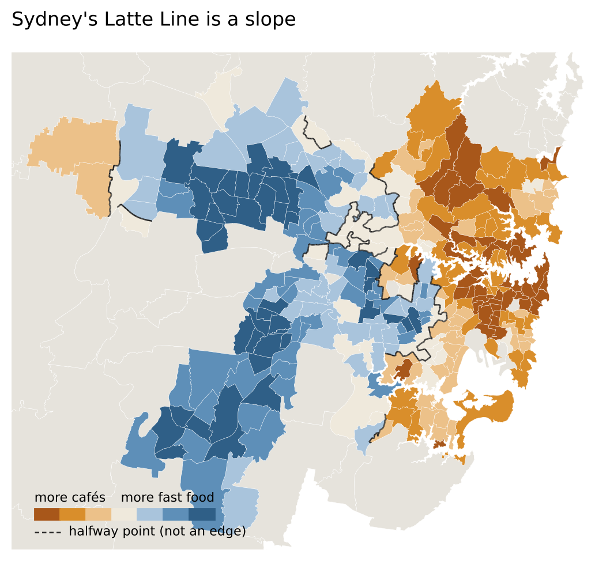

*Figure 1. The Latte Line as a slope. Each suburb is coloured by its café-versus-fast-food score, in seven equal-sized groups; the dashed line marks only the halfway point. Grey: areas left out (few residents).*

**The lockdown.** In August 2021 the NSW government put extra restrictions on a set of "local government areas of concern", mostly in the west and south-west. We test them on the exact NSW council boundaries. Their suburbs sit on the Latte Line's fast-food side far more often than in random Sydneys (balanced accuracy 80% against 50%, p = 0.005; 0.03 after correcting across the six claims tested with a p-value), and 78% of their residents lived there; leaving out Penrith, the least typical of them, gives 79%. The jobs line matches them at least as closely (82%), as do rent (79%) and household income (78%), in line with commentators who said essential manual workers bore the brunt. The test shows where the restrictions fell. It says nothing about why, or whether they were justified: the councils were chosen on case numbers.

### 9.6 The 2021 lockdown, council by council

Of all the claims about the Latte Line, this one touched the most lives, so we give it more than a line in a table.

**What happened.** Greater Sydney went into lockdown on 26 June 2021 as the Delta outbreak grew. In early July the NSW government singled out the Fairfield, Liverpool and Canterbury-Bankstown council areas in the south-west as the areas of most concern (The New Daily, 7 July 2021). The list grew through July: by late July about two million people in eight council areas could not leave their local area unless they were authorised workers (InDaily, 29 July 2021). On 12 August Bayside, Strathfield and Burwood were added, joining Parramatta, Georges River, Campbelltown, Fairfield, Canterbury-Bankstown, Liverpool, Blacktown, Cumberland and twelve suburbs of Penrith; the Premier said Strathfield and Burwood were added because their case numbers were rising relative to their populations (Concrete Playground, 12 August 2021). From late August the twelve "local government areas of concern" lived under rules the rest of Sydney did not: a 9pm–5am curfew, a one-hour exercise limit, a $1,000 fine for entering without a reasonable excuse, and vaccination mandates for childcare and disability workers (Canberra Times and Illawarra Mercury, August 2021). It was later reported that the Chief Health Officer had recommended consistent measures across all of Sydney, and community leaders said the harsher rules deepened a sense of being targeted (SBS News).

**What we test.** Whether the councils of concern lie on one side of Sydney's informal lines more than geography alone would produce. Each suburb (ABS SA2) is assigned to the council holding most of its area on the exact NSW council boundaries. The test statistic is balanced accuracy: the mean of the share of concern suburbs on a line's lower side and the share of other suburbs on its upper side. The null is the same as for the Latte Line itself: 999 random Sydneys with cafés and fast-food places redrawn from smooth landscapes fitted to the real ones. The whole Penrith council is counted, although only twelve of its suburbs were restricted; the check without Penrith is reported.

**Result.** The councils of concern sit on the fast-food side of the Latte Line far more often than in random Sydneys: balanced accuracy 80% against 50% (p = 0.005; 0.03 after Holm across the six Latte claims tested with a p-value). 78% of their 2.45 million residents lived on the fast-food side, against 18% of the rest of Sydney; without Penrith the accuracy is 79%. The jobs line (manual against managerial work) matches them better still: 82% balanced accuracy, with 82% of their residents on its manual side against 17% elsewhere. Rent (79%) and household income (78%) follow close behind.

| Council of concern | Residents (2021) | On the Latte Line's fast-food side | On the jobs line's manual side |
| --- | --- | --- | --- |
| Blacktown | 401,000 | 100% | 85% |
| Canterbury-Bankstown | 372,000 | 95% | 92% |
| Parramatta | 239,000 | 51% | 13% |
| Cumberland | 237,000 | 75% | 91% |
| Fairfield | 207,000 | 100% | 100% |
| Penrith (whole council) | 198,000 | 89% | 100% |
| Liverpool | 196,000 | 100% | 100% |
| Bayside | 188,000 | 0% | 94% |
| Campbelltown | 178,000 | 100% | 100% |
| Georges River | 136,000 | 19% | 80% |
| Strathfield | 50,000 | 40% | 0% |
| Burwood | 44,000 | 100% | 0% |
| **All twelve** | **2,446,000** | **78%** | **82%** |
| Rest of Greater Sydney | 2,121,000 | 18% | 17% |

*Table: share of each council's residents living in suburbs on each side, 2021 Census (ABS SA2), suburbs assigned to the council holding most of their area. Script: experiments/latte\_claims.py; results/latte\_claims/lockdown\_by\_council.csv.*

**What the councils tell us.** Six of the twelve councils (Blacktown, Canterbury-Bankstown, Fairfield, Penrith, Liverpool, Campbelltown) lie almost wholly on the fast-food and manual-work side of both lines, and Cumberland mostly so. The exceptions are informative. Bayside and Georges River are on the café side of the Latte Line but the manual side of the jobs line, which is why the jobs line fits the lockdown map better than the cafés do. Strathfield and Burwood are on the managerial side of the jobs line; they were the last councils added, and the stated reason was a rise in cases relative to their small populations. Parramatta straddles both lines. So the lockdown map is not the Latte Line: it is Sydney's work divide plus a few late additions.

**What the census cannot tell us.** The test shows where the harsher rules fell. It cannot say why. The government's stated criterion was case numbers, and case numbers in a Delta outbreak plausibly followed the same geography as the jobs line: essential work that cannot be done from home, larger households, more people per bedroom. On that reading the rules followed the virus, and the virus followed the work divide. Critics read the same map as a choice to treat some communities differently, a reading the later report of the Chief Health Officer's advice made sharper. Both readings predict the same map; only data on cases and transmission by area can separate them.

**The next test.** NSW Health publishes COVID-19 cases by postcode and date, so where the cases fell can be tested directly. Section 9.7 does this: Delta cases followed the jobs line and the Latte Line far more closely than chance allows. Two further questions remain open: whether suburbs with similar case rates outside the councils of concern stayed under lighter rules, and whether vaccination, prioritised in the hotspot councils from late July, caught up across the line (this needs vaccination data by postcode, which we have not downloaded). Throughout, we do not score heritage, ethnicity or language against the line: the question is where the rules and the cases fell, not who lives there.

**Intuition:** a map of where rules fell is like a map of where umbrellas are open. It tells you where it was raining, or where people were told to open umbrellas, but not which; to know that, you need a map of the rain.

**What does not.** Money falls the same way as the Latte Line, but it does not form a line, and it follows the jobs divide more closely than the café one: the line between haves and have-nots is more the Hi-Vis Line than the Latte Line. Nor was the divide hardening up to 2021: the Hi-Vis Line was a real line in every census from 2001, about equally sharp each time. The 2023 claim is about poverty since then, which the 2026 census can test.

**Intuition:** a nickname can be right about where a divide runs and wrong about how sharp it is. The Latte Line is a good map of a slope. Most of what is said about it is true of the slope; what fails is the idea of a wall.

### 9.7 Where Delta fell: COVID-19 cases and the lines

Section 9.6 showed where the 2021 rules fell. This section asks where the disease fell. The study was written down (`HYPOTHESES.md`, "COVID-19 cases and Sydney's lines") before the case data was downloaded. It is descriptive and spatial: it says where confirmed cases were concentrated, not why, and it does not judge the public-health orders.

**Data.** NSW Health publishes every confirmed case (PCR, 25 January 2020 to 7 February 2022; 973,412 cases) with its notification date and the postcode of usual residence; 1.4% have no postcode. Postcodes do not nest in suburbs, so each postcode's cases are shared out to the 300 Sydney suburbs (SA2) in proportion to the population in each overlap, using the ABS 2021 postcode-to-SA2 correspondence. Rates use 2021 Census population. The Delta wave (16 June to 15 December 2021, from the Bondi cluster to the arrival of Omicron) puts 67,293 cases in the study suburbs.

**Test.** Let r\_i be suburb i's Delta cases per 1,000 residents and f\_i the Latte Line field. The statistic is Spearman's correlation between the two. The null is the one used for every Latte Line claim: 999 random Sydneys whose café and fast-food maps are just as smooth as the real ones (Section 6.1), each giving its own correlation with the same case map. Since the case map is held fixed, the null keeps its spatial clustering, and only the line is randomised.

```latex
\hat\rho = \mathrm{Spearman}(r, f), \qquad p = \frac{1 + \#\{b : \rho^{(b)} \le \hat\rho\}}{1 + 999}
```

The Hi-Vis Line gets the same test against 999 landscapes fitted to its own map, and Holm runs over the two.

|  | Statistic | Random Sydneys (95% range) | p (Holm) |
| --- | --- | --- | --- |
| V1 Latte Line | ρ = −0.63 | −0.51 to 0.54 | 0.003 (0.003) |
| V2 Hi-Vis Line | ρ = +0.74 |  | 0.001 (0.002) |
| V3 Councils of concern vs rest | rate ratio 3.84 (bootstrap 95% CI 3.44 to 4.98) |  | descriptive |
| V4 Fast-food side vs café side | 2020: 0.74 (0.61 to 0.87) · Delta: 3.06 (2.47 to 3.75) · Omicron: 1.17 (1.03 to 1.30) |  | descriptive |

**Result.** Delta followed the line. On the fast-food side, 22.2 residents per 1,000 were confirmed cases (about 1 in 45); on the café side, 7.3 per 1,000 (about 1 in 137). The correlation with the Latte field is stronger than in 997 of 999 random Sydneys, and the jobs line predicts cases better still (ρ = 0.74), exactly as it predicted the lockdown councils (Section 9.6). The councils of concern had 3.8 times the rest of Sydney's rate; within them, Cumberland (38.9 per 1,000) and Canterbury-Bankstown (34.9) were highest, and Burwood (8.5) and Georges River (9.8) lowest.

The divide was not fixed. In 2020 the café side had more cases (ratio 0.74), seeded by returning travellers. During Delta the fast-food side had three times the rate. Under Omicron, which reached everywhere, the gap nearly closed (1.17). Figure 8 shows the weekly series.

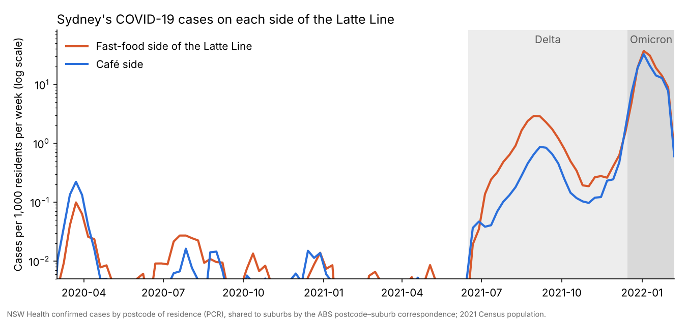

*Figure 8. Weekly confirmed COVID-19 cases per 1,000 residents on each side of Sydney's Latte Line, March 2020 to February 2022 (log scale). NSW Health cases by postcode of residence, shared to suburbs by the ABS correspondence.*

**Cafés or jobs? (exploratory, not pre-registered).** The two lines overlap heavily (Spearman ρ = −0.79 across the 300 suburbs), so we asked which carries the information. We rank the Delta rate, the Latte field and the Hi-Vis field, remove from each ranked variable a straight-line fit on the control, and correlate what is left (a partial Spearman correlation). The partial correlation of cases with the Latte Line holding Hi-Vis fixed is −0.11 (999 random Sydneys: 95% range −0.35 to 0.35, p = 0.30). The partial correlation with the Hi-Vis Line holding the Latte Line fixed is +0.52 (null range −0.40 to 0.42, p = 0.003). Among suburbs with the same mix of jobs, the café divide tells us nothing more about Delta; among suburbs with the same cafés, jobs still matter.

**Intuition:** the Latte Line predicted Delta because it is a good map of something else, namely where people's work had to be done in person. Coffee was the messenger, not the cause.

**What it cannot say.** Confirmed cases mix infection with testing, and testing was itself heavier where the outbreak was. The orders followed the cases, so the order map and the case map cannot be separated into cause and effect. The pre-registered mechanism check (V5) is mixed. Within each side, cases rise with the share of on-site jobs (ρ = +0.40 on the café side, +0.67 on the fast-food side), but household size is negatively related on the café side (−0.24) and only weakly positive on the fast-food side (+0.19). Work that could not be done from home tracks Delta more closely than crowded homes do. Deaths are not published by postcode, so they are not studied.

**Intuition:** the Latte Line started as a joke about coffee. In the second half of 2021 it also marked, more sharply than chance allows, where Sydney's Delta cases were three times as common. The joke and the outbreak share a cause the census can see: on one side of the line, more people's work could not be done from home.

## 10 Twenty-nine cities

### 10.1 The first 18 cities

Across 18 cities and 358 tested lines, 14 pass as real lines, in 10 cities; two kinds recur. The Factory Line passes in three industrial cities (Sydney, Birmingham, Manchester) and the Bicycle Line in three cities with flat cores and steep edges (Adelaide, Brighton, Kyoto). Everything else is a gentle slope or chance. Holm correction runs within each group of about four lines, so across roughly 80 groups about 4 false passes would be expected by luck; 14 is well above that, but any single pass outside the recurring two should be read with care.

| City | Areas | Lines tested | Real lines (corrected p) | Check |
| --- | --- | --- | --- | --- |
| Sydney | 300 | 15 | Hi-Vis (0.014), Factory (0.038) | calibrated |
| Birmingham | 315 | 20 | Factory (0.020) | calibrated |
| Manchester | 353 | 20 | Factory (0.040) | calibrated |
| Adelaide | 86 | 17 | Bicycle (0.015) | calibrated |
| Kyoto | 164 | 19 | Bicycle (0.020) | calibrated |
| Brighton | 165 | 15 | Bicycle (0.045) | calibrated |
| Brisbane | 200 | 18 | Latte (0.020) | calibrated |
| Fukuoka | 199 | 19 | Latte (0.040), Izakaya vs Italian & French (0.025) | calibrated |
| Kobe–Hanshin | 266 | 23 | Coffee vs Alcohol (0.040), Wine vs Sake (0.050) | calibrated |
| London | 1,002 | 22 | Greggs vs Pret (0.025), Waitrose vs Lidl & Aldi (0.025) | single fit; chain p exact |
| Melbourne, Perth, Liverpool | 307, 136, 201 | 19, 18, 20 | none | calibrated |
| Osaka, Nagoya, Yokohama–Kawasaki, Sapporo | 289, 199, 355, 222 | 23, 22, 23, 20 | none | calibrated |
| Tokyo | 454 | 25 | none | calibrated |

The double-check matters. Before it, Melbourne's Hi-Vis and Degree lines and Osaka's Wine vs Sake had raw p below 0.05; none survives calibration and correction. Close calls were refit with R = 200 so that the smallest attainable p (1/201) could clear Holm. London's census lines got only the single-fit test (about 8 minutes per line at its size), so its census verdicts are the less conservative kind; its chain verdicts use an exact label-swap test and do not depend on that.

### 10.2 Lines over time

Work lines are fixed features of a city; the Grey Line is fixed in Australia but not in Japan. The test (A.10) asks what share of areas sit on the same side of a line at the first and last census, against random lines of the same smoothness, which keep 52–57%.

*Interactive chart in the online version: Pipeline output (build\_app.py timeline step), 15 Nov 2026 · ABS Time Series Profile 2011–2021; e-Stat small areas 2000–2020 shared onto 2020 areas · permutation p ≤ 0.003 for every Hi-Vis row*

The Hi-Vis Line keeps 83–95% of areas on the same side in all 11 cities (p ≤ 0.003 each). The Living Alone and Tower lines in Japan behave the same way (83–93%). The Grey Line keeps 77–83% in Australia, but in Japan it ranges from 52% in Kyoto (p = 0.75) and 54% in Sapporo (p = 0.36) to 64% in Yokohama–Kawasaki. Tokyo's "Grey Flip" (section 9.4) is therefore a Japanese pattern, not a Tokyo one. In Australia the Grey Line is still the least stable line in every city: Factory, Degree, Living Alone and Flats vs Houses keep 87–99% of suburbs on their side over 2011–2021, against 77–83% for Grey. Age is the one thing that moves fastest everywhere; Japan is the case where it moves all the way to chance.

The Japanese window is 20 years against Australia's 10, which by itself makes reshuffling more likely. It does not explain the gap: the Hi-Vis Line stays above 83% over the same 20 years. A likely mechanism is ageing in place: older areas in Japan lose residents, while newer suburbs built for families in the 1970s–90s age as a block and cross over. This needs testing on 2010–2020 alone before it is claimed.

### 10.3 Contrasts between cities

The extra cities were chosen in pairs, so that one difference between two cities can be read against the results.

| Contrast | What differs | What the data show |
| --- | --- | --- |
| Kyoto vs Sapporo | 1,200-year-old grid vs a grid laid out in the 1870s | Both reshuffle the Grey Line (52% and 54% same side, both at chance). The age of the street plan does not decide whether older residents stay put. |
| Cycling cities and hills | Flat basins and plains next to steep edges (Kyoto, Adelaide, Brighton) | The Bicycle Line passes the full double-check in Adelaide, Kyoto and Brighton (corrected p 0.015–0.045) and is close in London, Nagoya and Tokyo (raw p 0.02–0.07). A plausible cause is terrain: cycling drops sharply where the hills start, which makes an edge rather than a slope. This is a hypothesis; slope data were not tested. |
| Melbourne vs Perth | Poker machines in pubs and clubs vs at the casino only | Perth has no Pokies Line because state law allows none outside the casino. Melbourne's line is a gentle pattern (p = 0.22 after correction), using 253 of 301 metro venues matched to licences by name. |
| London vs everywhere else | One very large city with 1,002 areas | London is the only city where chain wars pass: Greggs vs Pret and Waitrose vs Lidl & Aldi split it (exact label-swap p = 0.025 after correction). In the other 16 cities no pair of chains splits the city. |
| Adelaide and Brighton vs London | 86 and 165 areas vs 1,002 | Small cities give the tests less to work with: only very sharp lines can pass, so "gentle" there is weaker evidence of no line than it is in London or Tokyo. |
| Australia vs Japan | 10-year vs 20-year census windows | Work lines persist in both; the Grey Line persists only in Australia (10.2). |

Chains are the one finding that reverses with size. A chain's stores follow its customers, so its map is usually a blur of the city's density; only London has enough stores of each brand for a class pattern (Pret nearer in north-west London, from St John's Wood to Chiswick; Greggs nearer in the outer east, such as Hainault and Harold Hill; Lidl and Aldi nearer in Becontree and Walthamstow) to stand out from the blur.

### 10.4 Line families

A city with 20 lines does not have 20 divides; it has about four. Correlating every pair of line scores within each city and averaging over cities, the lines cluster into four families: work and class, the inner city, age, and the night out.

*Interactive chart in the online version: Pipeline output, 15 Nov 2026 · Pearson correlation of rank-normal line scores, averaged over the 16 cities that have them (Sydney and Tokyo use a different line set) · boxes = average-linkage clusters on 1 − |r|*

The families are stable from city to city. The Hi-Vis and Degree lines are near mirror images everywhere (r between −0.78 and −0.97 in all 16 cities), as are No Car and Renters (0.74 to 0.92). Two links vary and are worth reading city by city. The Latte Line ties to Degree at 0.70 in some cities and 0.19 in others, so it is a class line in some places and a going-out line in others. The Grey Line runs against renting strongly in England (−0.87 in Manchester) but weakly elsewhere. For planners, the practical reading is to pick one line per family before comparing cities, because two lines from the same family are largely the same evidence counted twice.

**Do a family's lines share one border?** Lines in a family are correlated, so they will often fall on the same side. The question is whether they also change at the same borders more than that correlation implies, which would mean one hard divide rather than several soft ones. We count the share of changing borders where two or more of the family's lines change together, and compare it with simulated cities where each line has its own landscape and the lines are mixed to their real correlations (Appendix A.13).

Of 48 family tests (three families in 16 cities), 2 pass at the 5% level: the night-out pair in Yokohama (42% shared borders against 33% expected) and in Fukuoka (40% against 30%). About 2.4 would pass by chance alone.

**Intuition:** a family is a set of correlated slopes, not one wall. Its lines sit near each other because the things they measure go together.

### 10.5 Urban rules beyond the correlation table

A rule reads "where A is high and B is low, C tends to be high", with high and low meaning the top and bottom third of a city's areas. Rules like this are easy to find and mostly empty: if A, B and C are correlated, the rule follows from the correlations alone. We therefore score each rule twice.

- **Beyond correlation:** how much more often C is high than a map with the same rank correlations would give (a Gaussian copula).
- **Beyond smooth chance:** the same excess on 99 simulated cities in which every variable has its own fitted multi-scale landscape and the variables are mixed to the real correlations. A rule passes if its excess beats at least 95% of these.

Each city has 3,960 candidate rules; we keep those that at least 12 areas match (1,584 in Adelaide, up to 3,726 in London). Overall 12% pass, against 5% expected by chance. The rate varies: 15–18% in Melbourne, Brisbane, London, Birmingham and Manchester, 8–14% in most other cities, and 4% in Adelaide, which with 86 areas has the least to work with.

A typical passing rule: where over-65s are few and detached houses are few, walking to work is high in 94% of such areas in Melbourne, 81% in Brisbane and 85% in Perth, against 69%, 61% and 53% expected from the correlations alone. Adelaide has only 9 such areas, too few to test.

We call a rule consistent in a country if it passes in every city of that country where it can be tested, and can be tested in at least three. That leaves 23 rules in Australia, 19 in England and 2 in Japan. Examples: in Australian cities, few over-65s plus many people living alone goes with many degrees; in English cities, many children plus many managers goes with many professionals and more cycling.

**Transfer.** Each country's consistent rules were checked in the other countries' cities, wherever at least 12 areas match; a rule transfers to a city if it passes there with a positive excess. Australian rules pass in 32% of Japanese and 23% of English cases; English rules in 29% of Australian and 13% of Japanese ones. Japan's two rules transfer well (83% and 67%), but two is too few to read much into.

**Intuition:** a planner can borrow a city's correlations, but its finer rules travel badly, especially to Japan. Most of what looks like a law of cities is the correlation table seen from another angle.

### 10.6 Sister cities (exploratory)

Two cities can be alike in how their places relate rather than in their levels. For each city we take the rank correlations among 11 shared measures (age, living alone, houses, degrees, jobs, travel to work), giving 55 numbers, and measure the distance between two cities' sets.

The closest pair across countries is Sapporo and Brighton (distance 0.19; 83 cross-country pairs). Bootstrapping areas gives \[0.18, 0.24\], well clear of the tenth-closest pair at 0.32. Brighton is built from 165 small areas; merging them into its 33 middle-sized areas, to match the other English cities, leaves the distance unchanged at 0.19 and the pair still first. So the match is not an artefact of area size.

We report this as exploratory. Eleven measures is a thin fingerprint, the correlations do not care where in the city things happen, and there is no test of whether 0.19 is unusually small for two cities this size.

**Intuition:** in both cities the same kinds of place go together: who lives alone, who has a degree, who drives. That is a claim about structure, not about Sapporo looking like Brighton.

### 10.7 A held-out test: eleven new cities

Everything above was found on 18 cities. To see what survives contact with new data, we wrote 58 predictions down and committed them to the repository before opening the data for eleven more cities: eight in the United States (New York, Los Angeles, Chicago, San Francisco–Oakland, Washington, Austin, Seattle, Miami), Auckland, Christchurch and Singapore. Every setting stayed fixed; the one change, counting light rail as rail in US commuting to match the English definition, is recorded with its reason. Two predictions about pooling were added during the phase and are marked as weaker.

Of 60 predictions, 29 held, 15 failed, 6 partly held and 10 could not be tested with this phase's data (mostly change over time, which needs earlier census years). The full table, with the figure and p-value behind each verdict, is in the repository (HYPOTHESES.md).

**What each result can bear.** Many analyses run in this paper, so we sort the headline results by status. Confirmatory results were written down before the data were opened and scored by a fixed rule. Weaker ones were written during Phase 1, before the numbers they use were computed. Exploratory ones were found by looking and count only once new data confirm them; most are already on record as predictions for Europe.

| Result | Status | Evidence | Confirmed by |
| --- | --- | --- | --- |
| Moran spectral randomisation fails on new city shapes | Confirmatory (H2) | 26–66% false alarms | Phase 1 ✓ |
| Few lines pass (< 10%) | Confirmatory (H11) | 11 of 167 (7%) | Phase 1 ✓; Phase 2 P6 |
| Slopes, not cliffs | Confirmatory (H19) | 94% no sharp stretch | Phase 1 ✓; Phase 2 P11 |
| Quick test < 8% false alarms | Confirmatory (H1) | failed: Chicago 10% | Phase 1 ✗ |
| Calibrated test holds its size | Exploratory check, method fixed in advance | Chicago 5 of 72 (6.9%) | Phase 2 P1 |
| Work lines recur in new cities | Confirmatory (H12) | failed: 1 city | Phase 1 ✗ |
| Factory, Laptop, Degree, Bicycle are general | Weaker (H59) | failed: Z = 1.2–2.0 | Phase 1 ✗; Phase 2 P8 |
| The Latte Line holds in new cities | Exploratory (pooling every line) | p = 0.02 (calibrated pooling, Holm across lines) | Phase 2 P7 |
| US cities split by shopping | Exploratory | 3 of 8 US cities | Phase 2 P10 |
| Money is a slope that follows class | Exploratory | 0 of 14 after Holm; 12 of 12 AU/US routes | Phase 2 P13, P14 |
| No grammar beyond shared gradients | Exploratory | 1 of 26 cities | Phase 2 P15, P16 |
| Country lines | Exploratory | Factory in Australia (0.008) and England (0.006) pass calibrated pooling; Bicycle (AU), Degree (UK), Latte (US) lean | new cities in those countries |
| Latte claims: lockdown councils on the fast-food side | Exploratory (one test fixed per claim before running it) | p = 0.005; 0.03 after Holm across six claims (exact council boundaries) | exact council boundaries |
| Latte claims: route; degrees | Exploratory | p = 0.03 and 0.01; 0.08 and 0.07 after Holm | none yet |
| Latte claims: no hardening 2001–2021 | Exploratory | Hi-Vis line real in every census | 2026 Census |
| Verdicts barely change with smaller areas | Confirmatory (H49) | 3 of 56 change | Phase 1 ✓ (four cities) |
| Ranking hides jumps | Confirmatory (H10) | 12% → 1% (Seattle) | Phase 1 ✓; Phase 2 P4 |

**The method claims held.** On the new cities' own shapes, the published Moran spectral randomisation called a line on 26–28% (Seattle) and 65–66% (Chicago) of smooth maps with no line, and on 99% of Chicago's centre-to-edge gradients. The landscape test's single-fit version called 6% and 10% on smooth maps and 0–2% on gradients.

| Map with no line | MSR, Seattle / Chicago | Landscape, single fit, Seattle / Chicago |
| --- | --- | --- |
| Smooth | 26–28 / 65–66 | 6 / 10 |
| Centre-to-edge gradient | 49–60 / 99 | 2 / 0 |
| Smoothness varies | 24–30 / 82–85 | 10 / 8 |
| Stretched one way | 40–41 / 71–73 | 10 / 5 |

False-alarm rate (%) at the 5% level; 200 maps per cell in Seattle, 100 in Chicago.

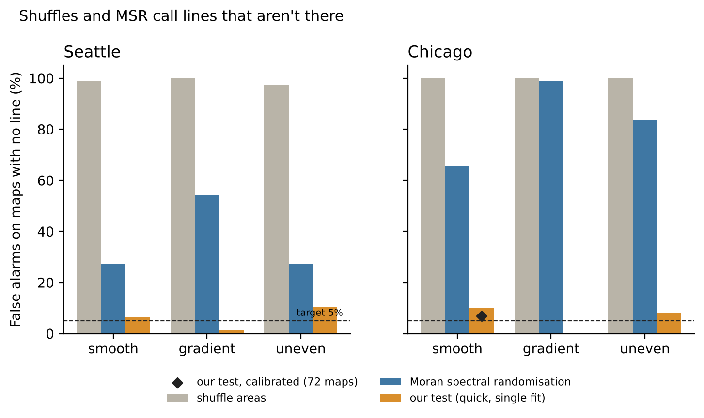

*Figure 3. False alarms on simulated maps with no line, in the shapes of Seattle (100 areas) and Chicago (401): smooth landscapes, centre-to-edge gradients, and landscapes whose smoothness varies across the city. MSR averaged over its singleton, pair and triplet forms. Diamond: the calibrated test, run as every verdict is (72 maps).*

One prediction about our own test failed: the single-fit version reached 10% false alarms on Chicago's smooth maps (10 of 100, p = 0.03 against 5%), above the 8% we predicted. Every verdict in this paper, though, uses the calibrated version (Section 5.3), which refits the landscape on simulated maps and gives close calls 200 refits. On 72 fresh Chicago maps with no line, run exactly as the verdicts are, it called a line on 5 (6.9%; 95% interval 2.3–15.5%, p = 0.29 against 5%). The single-fit test called 3 of the same 72, so across both runs it called 13 of 172 (7.6%). The weakness is therefore mild and belongs to the quick test; the calibrated test holds its size within the precision we can afford.

Why does the quick test drift above 5% at all? Because one map cannot pin down landscape scales as large as the city itself. On simulated Chicago and Seattle maps, the broad scales (25 and 50 km) carry about a quarter of the variance (23% and 24%), but the single fit gives them 13% and 1%. The simulated cities therefore come out a little too rough, and their median splits a little too ragged: the null's border count sits about a third of a standard deviation above the truth (+0.32 SD in Chicago, +0.39 SD in Seattle). The bias is the same size in a city of 100 areas and one of 400, so it is not a big-city problem; it is what calibration is there to absorb.

**Intuition:** judging how hilly a country is from one walk across it, you will notice the bumps but miss that the whole walk was uphill. The test does the same with one map, and calibration corrects it by checking how often the walk fools us.

**Few lines are real, and they are slopes.** 11 of the 167 lines tested pass (7%), and 132 of 140 lines with a sharp-stretch test have no sharp stretch at all. The same four families of lines reappear: 11 of 13 lines fall into the family they belonged to in the first 18 cities.

**Which lines exist does not transfer.** Pooled over the first 18 cities, four lines looked real in general: the Factory, Laptop vs Hard Hat, Degree and Bicycle Lines (Z = 3.2–5.4). Pooled over the new cities they are not (Z = 1.2–2.0; none survives correction across lines). The one line that holds up is the Latte Line (Z = 3.6 over 11 cities). Pooling needs its own check: even with no line anywhere, our calibrated p-values lean slightly low (on the 72 empty Chicago maps their average z is +0.15 rather than 0), and Stouffer's method adds such leans up, so pooling 11 such cities would give 14% false alarms at the 5% level. We therefore compare each pooled Z with two million pools of p-values from those empty maps. The Latte Line keeps p = 0.001 by that yardstick, 0.02 after correction across the 14 lines pooled; nothing else passes. We did not predict this in writing; it is exploratory until Phase 2, where it is prediction P7. The Hi-Vis Line points the same way (Z = 2.2, p = 0.014 alone, 0.17 after correction) and passes outright in New York.

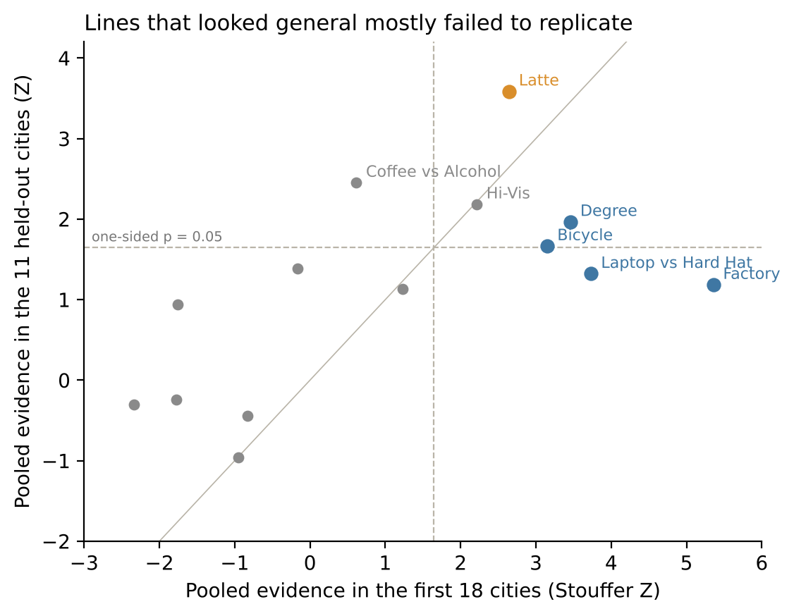

*Figure 2. Each line's pooled evidence (Stouffer Z over cities) in the first 18 cities against the 11 held-out ones. Blue: the four lines that looked general at first. Orange: the Latte Line. Dashed: one-sided p = 0.05 before correction.*

**American cities sort by shopping.** The passing lines in the new cities are mostly about where people shop and drink: Starbucks vs Dunkin' in New York, the Latte Line and Whole Foods vs Walmart in Los Angeles, the Latte, Coffee vs Alcohol and Drink Out vs Drink In Lines in San Francisco (whose fourth line, the Grey Line, is the only age line to pass anywhere), and Cold Storage vs FairPrice in Singapore. Auckland, Christchurch, Washington, Seattle, Austin, Miami and Chicago have no real lines.

**Intuition:** a search over 18 cities finds patterns that look general because they were chosen for looking general. Holding cities out is the only way to tell a law of cities from a coincidence of the cities you happened to search. Here, the test survived; most of the laws did not.

### 10.8 Beyond single lines: area size, money, grammar, countries and the smallest step

**Smaller areas tell the same story.** We rebuilt Seattle, Austin, Washington and San Francisco from census tracts, with roughly twice as many areas each, and reran every test. Of 56 verdicts, 3 change: San Francisco's Train vs Car Line becomes real (p = 0.015) and its Grey Line becomes a gradient (p = 0.06), and Austin's Latte Line becomes real, just (p = 0.05). No real line became a chance pattern. The answers do not hinge on how the areas were drawn.

**Money is a slope, not a line.** Median rent gives a fourteenth line in every city with rent data: the four Australian cities, the eight American cities, Auckland and Christchurch. It passes in none after correction across cities. The lowest is Christchurch (p = 0.025 alone, 0.35 corrected), which is what one city in fourteen should produce by chance. Where money's median split runs is more interesting than whether it is sharp. In all 12 Australian and American cities, the Hi-Vis or Degree Line is one of the two lines whose split matches rent's best (69–83% of areas on the matching side). In New Zealand rent follows renting and car ownership instead (80–88%). Rent tracks class in Australia and the US, and housing tenure in New Zealand.

**Cities have no grammar beyond their gradients.** Give each area a four-letter word: its side of the median on work and class, inner city, age, and nightlife. Do neighbouring areas' words go together more than chance allows? Against simulated cities that only copy each line's smoothness and the lines' correlations, 19 of 26 cities have a grammar (p ≤ 0.05). But when the simulations also keep the broad gradients that the lines share, so that the inner city is the same inner city for every line, 1 of 26 does (Auckland, p = 0.03; 1.3 expected by chance). The apparent grammar is the shared gradients: there is one big map underneath, and the four letters read it four ways. The leftover word-pair patterns are slightly more alike within a country than across countries (correlation 0.23 vs 0.13).

**Only big steps are visible.** How large must a real step be for our test to see it? In Los Angeles (401 areas) a step of 2 standard deviations across a border is detected 10–12% of the time, and a 3 SD step 36–46%. In Seattle (100 areas), 8–9% and 17–21%. A city can have a real step of 2 SD that no census-scale test will find. A failed test therefore means "no step large enough to see", not "no step". The same simulations confirm the pitfall of Section 8.2: ranking the data first cuts the edge test's power at a 3 SD step from 54% to 8% in Los Angeles, and from 12% to 1% in Seattle.

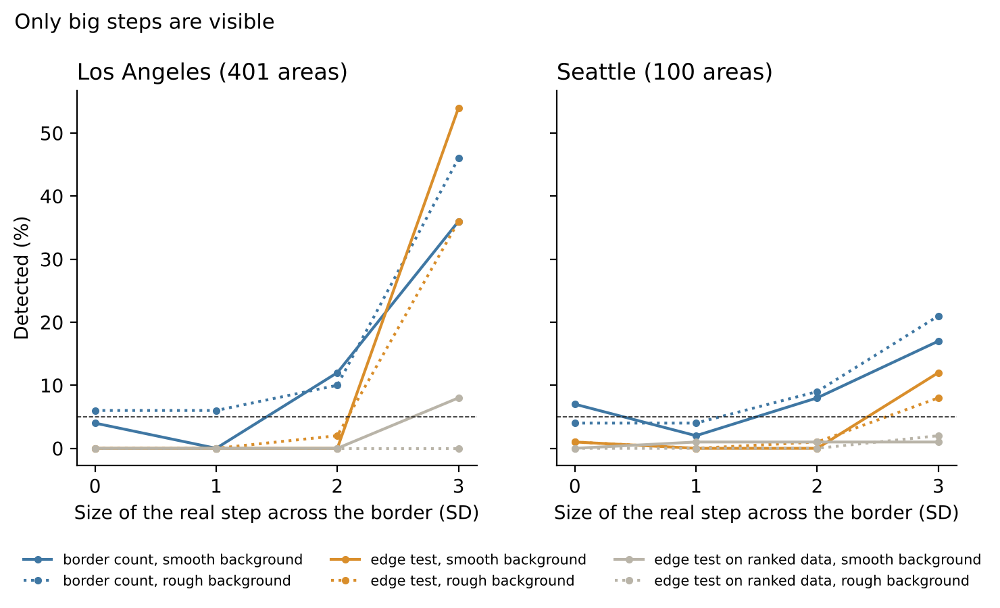

*Figure 4. How often a real step of a given size, placed along a realistic border, is detected at the 5% level (50–100 maps per point). Grey: the edge test after ranking the data first, which hides jumps.*

**Pooling buys power, at a price.** If the same modest step existed in many cities, pooling would find it. Drawing cities from the Los Angeles and Seattle power maps, a 2 SD step pooled over 11 cities is found 57% of the time, and over 29 cities 94%; a 3 SD step is found every time. But pooled tests inherit any lean in the single-city p-values: with no step at all, Stouffer pooling of quick-test p-values over 11 cities raises false alarms to 14%. Pooling is only safe with the check against empty maps described in Section 10.7 (results/pooled\_power.txt).

**Countries have lines that their cities cannot show alone.** Some lines exist only in one country (Japan's Wine vs Sake, England's Betting Shop Line, every chain pairing), so they cannot be compared across countries at all; and even shared lines may be real in one country and not another. We pooled each line over the cities of one country (Stouffer's method, checked against pools of empty maps as above, Holm across that country's lines). Two country lines pass: the Factory Line in Australia (p = 0.008) and in England (p = 0.006). Three more lean the same way but do not survive the check: the Bicycle Line in Australia (0.10), the Degree Line in England (0.12) and the Latte Line in the US (0.06). The Factory Line is real across Australia although it passes in none of the four cities alone: each city's evidence is too weak, but they all lean the same way. No Japanese line passes, and no line is detectably stronger in one country than in the others (Mann–Whitney on city z-scores, all p > 0.3 after correction), so a country's identity lies more in which lines it has than in how strong the shared ones are. The Australian and English results come from the cities we first explored and still need new cities in those countries to confirm them.

**Is the Latte Line just mapping or density?** OpenStreetMap is filled in unevenly, so a venue line could partly measure how well an area is mapped. In 27 cities the Latte Line's score rises with mapping intensity (food venues per km²; median Spearman ρ = +0.19) and, less, with population density. We took both out (the residual of a fit on their ranks) and ran the same quick landscape test on what was left. Over all 27 cities it barely moves (Stouffer Z = 4.47 before, 4.19 after; p = 0.005 after, checking the pooling against empty maps as above). Over the 11 held-out cities alone it weakens to borderline (Z = 3.62 before, 2.42 after; p = 0.09). One city loses it: San Francisco, where p rises from 0.01 to 0.47, so its Latte Line is mostly a mapping-and-density pattern. Both runs use the single-fit test, so the comparison is like for like rather than a verdict (results/osm\_sensitivity.csv).

## 11 Europe, Canada and thirty years of change

The second held-out phase was written down on 16 November 2026, before any of its data were opened, and every later definition (venue tags, chain lists, Canadian variables, the time questions) was committed before its first test. It adds ten European cities (Paris, Lyon, Marseille, Berlin, Munich, Hamburg, Madrid, Barcelona, Rome, Milan), five Canadian ones (Toronto, Ottawa, Montreal, Calgary, Edmonton, plus Gatineau for one test) and census series reaching back to 1990.

**Areas.** Censuses here are published on very different units, so everything is moved onto one: 1 km grid cells (ETRS89-LAEA in Europe, Statistics Canada Lambert in Canada). Census sections are shared out by area, cells with fewer than 1,000 residents are dropped, and the largest connected piece is kept, with rook neighbours. A cell value is then a ratio of shared-out counts, ranked to normal scores before testing, exactly as in Phases 0 and 1.

### 11.1 Named borders

Some divides have a name and a route: Madrid's north and south, Barcelona's Diagonal, the Berlin Wall. For a border that splits the areas inside it into two sides s\_i ∈ {0, 1}, we split the line's map at its median, z\_i = 1{f\_i > median(f)}, and count how many areas land on the matching side:

```latex
M(f) = \max\Big( \tfrac{1}{n}\sum_i 1\{z_i = s_i\},\; \tfrac{1}{n}\sum_i 1\{z_i \neq s_i\} \Big)
```

The null is the same fitted multi-scale landscape as the line test (999 simulated cities), and the p-value is calibrated the same way: simulate a city from the fit, refit, recompute its p, and ask how often a city with no border gets a p as small as the real one (200 refits).

**Madrid's north–south divide holds on degrees.** 78% of the city's 246 cells sit on the side the folk divide predicts, against 59% for random Madrids; single-fit p = 0.004, calibrated p = 0.005 (none of 200 refits did as well), Holm over the four pre-registered variables 0.02. Unemployment follows the border less clearly (74%, calibrated p = 0.040, Holm 0.12). For this border the single fit was nearly honest: refit maps with no border were called significant 6–8% of the time at the 5% level. Barcelona's Diagonal fails, as predicted (best match 66% vs 58%, p = 0.15), and no Berlin line follows the Wall (p = 0.31 to 0.90).

**Intuition:** a named border is a specific claim ("these districts differ from those"), so it can be tested much more sharply than "somewhere there is a line". Madrid passes because the degree map is not just a slope from centre to edge; it breaks along the district boundaries people already talk about.

### 11.2 Food lines

For a pair of venue types A and B (cafés and fast food, bakeries and fast food, independent and chain bakeries), each cell gets

```latex
f_i = \log\frac{A_i + 1/2}{B_i + 1/2}
```

ranked to normal scores and given the landscape test; a line needs at least 30 venues of each type in the city. Every line with quick p < 0.2 was given the calibrated check with 40 refits (smallest attainable p 1/41 = 0.024), and every line whose calibrated p was then below 0.1 was rerun with 200 refits (smallest attainable p 1/201 = 0.005). Calibration moved p in both directions. The lines with quick p < 0.2:

| Line | City | Venues (A vs B) | Quick p | Calibrated p (refits) |
| --- | --- | --- | --- | --- |
| Latte (cafés vs fast food) | Barcelona | 1,836 vs 815 | 0.030 | 0.010 (200) |
| Latte | Ottawa | 381 vs 907 | 0.015 | 0.010 (200) |
| Latte | Marseille | 301 vs 513 | 0.020 | 0.010 (200) |
| Latte | Rome | 1,944 vs 844 | 0.070 | 0.020 (200) |
| Latte | Paris | 3,724 vs 5,587 | 0.130 | 0.045 (200) |
| Latte | Calgary | 480 vs 923 | 0.160 | 0.122 (40) |
| Croissant (bakeries vs fast food) | Paris | 3,706 vs 5,587 | 0.005 | 0.005 (200) |
| Croissant | Lyon | 571 vs 800 | 0.155 | 0.122 (40) |
| Bread (independent vs chain bakeries) | Hamburg | 320 vs 96 | 0.025 | 0.005 (200) |
| Paella (Spanish restaurants vs fast food) | Barcelona | 597 vs 815 | 0.045 | 0.045 (200) |
| Timmies (Tim Hortons vs independent cafés) | Toronto | 460 vs 978 | 0.125 | 0.040 (200) |

Pooled over the ten European cities with Stouffer's method (calibrated p where it exists, quick p otherwise), the Latte Line gives Z = 2.67, p = 0.004, so the Phase 1 finding that it travels (P7) holds in Europe; Barcelona, Marseille and Rome carry it (calibrated p = 0.010, 0.010 and 0.020) and Paris is weaker (0.045). It does not hold in Canada (Z = 0.25, p = 0.40), where only Ottawa shows it (0.010). Plain Stouffer is slightly generous, because p-values from maps with no line lean low; the pooled-null correction of Section 10 is still to be run on these pools. With 200 refits two of the food lines now pass after Holm: Paris's Croissant Line (calibrated p = 0.005; Holm over the three French cities 0.015) and Hamburg's Bread Line (0.005; Holm over the two German cities with enough chain bakeries 0.010). The Paella Line fails (Barcelona 0.045, Holm over Madrid and Barcelona 0.09), as does the Timmies Line (Toronto 0.040, Holm over Toronto and Calgary 0.08). The Starbucks Line could only be tested in Paris and Madrid, where Starbucks simply sits in the centre (Spearman ρ with distance −0.51 and −0.47; Madrid calibrated p = 0.29): a slope, not a line.

**The Poutine Line** is a two-group question rather than a map: is poutine a larger share of fast food on the Quebec side of the Ottawa River? It is: 15 of 194 fast-food places in Gatineau (7.7%) vs 15 of 1,130 in Ottawa (1.3%), one-sided Fisher p = 4 × 10⁻⁶. Restaurants cluster, so we also resampled whole 1 km squares (20,000 times): the difference is 6.4 points, 95% interval 3.1 to 10.6, p < 10⁻⁴. Counting each restaurant name once gives the same answer (15 of 119 names vs 12 of 629, p = 2 × 10⁻⁶).

**Intuition:** a food line asks whether one kind of shop gives way to another along a boundary, rather than thinning out gradually. Cafés against fast food does this in several southern European cities, and bakeries do it in Paris (against fast food) and Hamburg (independent against chain); most other pairs only slope from centre to edge. The poutine result is a cultural border rather than a class one, and it is large enough that no reasonable correction removes it.

### 11.3 Canada's census lines

The same five census lines as Spain were built for Canada (Grey, Living Alone, Renters, Degree, Jobless). Of 25 city–line tests, none passes after Holm within its city (lowest: Toronto Jobless 0.02, Montreal Renters 0.02, Edmonton Degree 0.035), consistent with P6. Pooled across the five cities, Degree gives Z = 2.52 and Renters Z = 1.69, so renting leans towards a line in Canada, against P9; the Grey Line does not (Z = −0.71). Living alone falls from centre to edge in all five (ρ = −0.34 to −0.70).

### 11.4 Do lines move?

The tests so far ask whether a line exists in one census. With series on fixed units (NHGIS tracts standardised to 2010 boundaries for eight US cities, 1990–2020; Italian census sections 1991, 2001, 2011 and 2021 on the Rome and Milan cells; German Zensus 2011 and 2022 on the Berlin, Munich and Hamburg cells) we can also ask whether it moved. For each variable and year t we take the centre-to-edge slope

```latex
\rho_t = \mathrm{Spearman}(f_t, d), \qquad \Delta = \rho_{\text{last}} - \rho_{\text{first}}
```

where d is distance from the population-weighted centre. Neighbouring areas are alike, so a naive standard error for Δ is too small; instead we group areas into 5 km squares, resample whole squares 2,000 times, and recompute Δ each time. The p-value is two-sided, with Holm over all 37 city–variable tests.

**Housing and household lines stay put.** The share of renters and of people living alone changed slope by less than 0.07 in 20 of 24 cases (the exceptions: living alone in Miami, Austin and Chicago, renting in Austin), and keeps the same median-split side on 82–97% of areas from one census to the next.

**The age line moves.** The over-65 slope rose in all 13 cities measured: older residents are spreading outward (sign test p = 2 · 2⁻¹³ = 0.0002). The rise survives Holm in Los Angeles (+0.19, 95% interval +0.11 to +0.27), Washington (+0.37, +0.19 to +0.52), Milan (+0.82, +0.53 to +0.97), Berlin (+0.18, +0.11 to +0.24) and Hamburg (+0.11, +0.05 to +0.17). Milan is the extreme case: in 1991 its over-65s were concentrated in the centre (ρ = −0.76); by 2021 they were spread evenly (ρ = +0.06), and only 45% of cells keep their 1991 side. Rome barely moves (−0.65 to −0.60).

**Living alone is mostly a centre-to-edge slope, but not everywhere.** It falls outward in every census in Rome, Milan, the three German cities, the five Canadian cities and Austin, Seattle, Washington, San Francisco and New York, but is flat in Chicago, Los Angeles and Miami (ρ between −0.18 and +0.09). So time question T3 holds in Europe and Canada but fails for three of eight US cities.

**Intuition:** where people rent, or live alone, is fixed by the housing stock: flats near the centre, houses at the edge, and buildings change slowly. Age is not tied to buildings in the same way. People who bought suburban houses decades ago have grown old in them while younger people move into the centre, so the age map slides outward even though nobody's house moved. A test that looks at one census sees an age line; the series shows it is a moving front.

All Phase 2 numbers are produced by the scripts in `experiments/` (`phase2_es_it.py`, `phase2_food.py`, `phase2_canada.py`, `border_calibrated.py`, `poutine_cluster.py`, `time_*.py`, `time_change_test.py`) and recorded in `FINDINGS.md`.

## 12 The age front, sister cities and meme lines

Phase 3 adds ten cities with long or new series: Amsterdam, Rotterdam, The Hague and Utrecht (Dutch 100 m grid, 2011–2023), Stockholm, Gothenburg and Malmö (Swedish 1 km grid, 2015–2025), Copenhagen and Aarhus (Eurostat 2021 grid) and São Paulo (IBGE census sectors, 2010 and 2022). Five questions were written down before the first statistic (Q1–Q5, HYPOTHESES.md). Areas and tests are those of the previous section: 1 km cells with at least 1,000 residents, rank-normal fields, the landscape test, and the 5 km block bootstrap for change.

**Q1, the age front.** Pooling the 13 Phase 2 cities with the eight new ones that have two or more censuses, the over-65 slope (60+ in São Paulo, the only band in both censuses) rose in 18 of 21 cities, sign test p = 0.0015. The four Dutch cities all moved outward (The Hague +0.29, Holm-corrected p = 0.01; Utrecht +0.39; Rotterdam +0.20; Amsterdam +0.04), as did São Paulo (+0.11, Holm 0.01). The three Swedish cities moved the other way between 2015 and 2025 (Stockholm −0.11, p = 0.02 alone, 0.33 after Holm; Gothenburg −0.20; Malmö −0.10). Sweden has the shortest series; we report it as the one clear exception rather than explain it away.

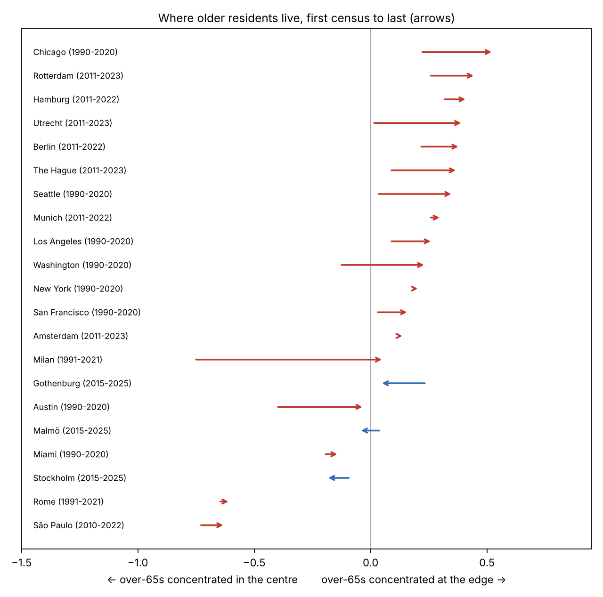

*Figure 5. Centre-to-edge slope of the over-65 share (Spearman correlation with distance from the population-weighted centre), first census (arrow tail) to last (arrow head). Red: moved outward; blue: moved inward.*

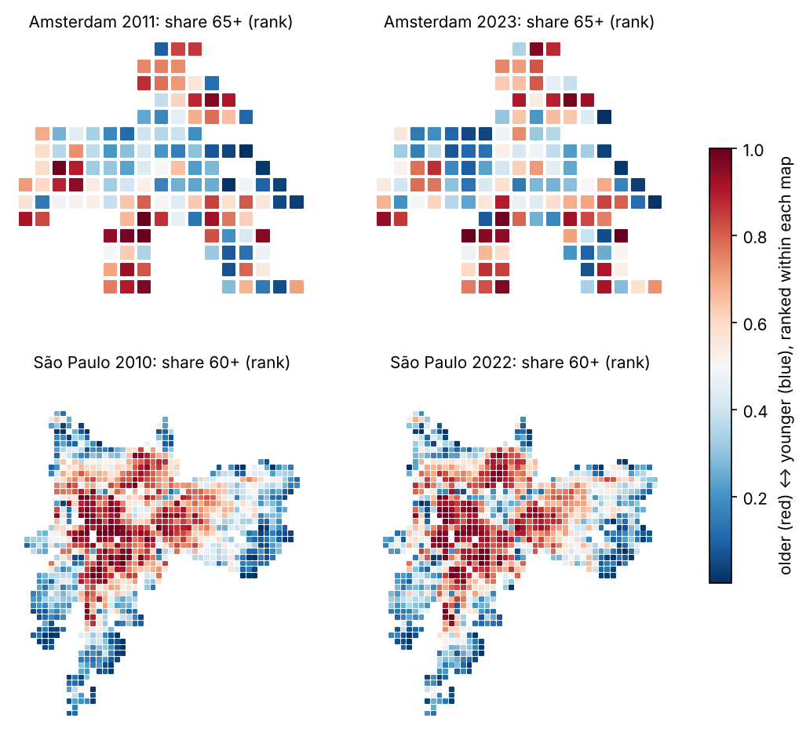

*Figure 6. Share of older residents in each 1 km cell, ranked within each map. In both cities the older (red) cells spread from the core towards the edge between the two censuses.*

**Q2–Q4.** Housing lines stay put: renting, living alone and household size changed slope by less than 0.1 per decade in 11 of 13 city–variable pairs (85%). Living alone falls from centre to edge in every Dutch city and year. Few lines pass: 1 of 25 quick-tested city–lines survives Holm within its city (the Aarhus Grey Line, quick p = 0.005; calibrated with 200 refits, p = 0.005, and refit maps with no line were called significant only 2.5% of the time, so the line stands), so the main result of the paper, slopes rather than lines, holds in three more countries.

**Intuition:** the buildings fix where renters and people living alone are, so those maps barely change in a decade. People are not fixed: the generation that bought suburban houses has grown old in them, so the age map drifts outward while the housing map stands still.

**Q5, sister cities.** Each city gets a profile: its centre-to-edge slopes for age, living alone and renting in its latest census. Two cities are sisters when their profiles are close. For 13 of 22 cities the closest sister is in the same country (59%; a permutation of country labels gives p = 0.001), so national housing systems leave a fingerprint. The cross-border pairs are the interesting ones: Amsterdam's nearest sister is Washington, Hamburg's is Seattle, Madrid's is Calgary, Barcelona's is Edmonton, Austin's is Toronto.

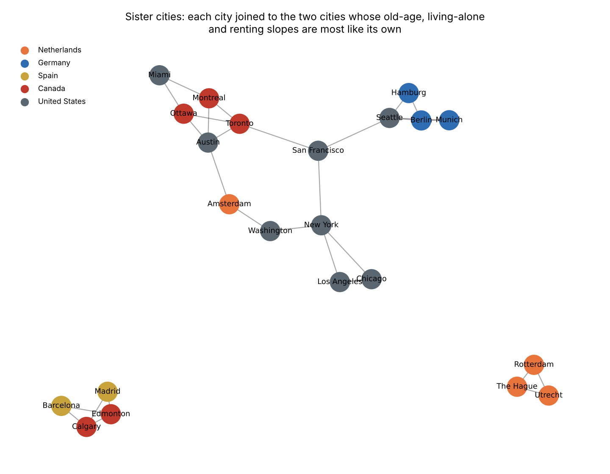

*Figure 7. Each city joined to the two cities whose age, living-alone and renting slopes are closest to its own. Colour: country.*

**Intuition:** cities in one country share a housing market, planning law and history, so their gradients look alike; a planner looking abroad for a city that "works like ours" should start with the sister, not the nearest neighbour on the map.

**Meme lines and the Latte Line in the new cities.** Three local food lines were written down before the venue maps were cut: São Paulo's *Coffee vs Churrasco* (cafés against churrascarias, predicted a slope, not a line), the Dutch *Snackbar vs Koffiebar* and the Swedish *Fika Line* (both cafés against fast food, predicted to fail). Each uses the cell field below on the 1 km cells, rank-normalised, and the quick landscape test (199 draws, m = 9). The slope ρ is Spearman's correlation between f and distance from the population-weighted centre. Holm runs over all eleven tests.

```latex
f_i = \log\frac{A_i + 1/2}{B_i + 1/2}
```

| City | Line | Cafés | Other | p | ρ |
| --- | --- | --- | --- | --- | --- |
| Amsterdam | Snackbar vs Koffiebar | 740 | 743 fast food | 0.89 | −0.30 |
| Rotterdam | Snackbar vs Koffiebar | 256 | 450 fast food | 0.37 | −0.11 |
| The Hague | cafés vs fast food | 324 | 546 | 0.88 | 0.13 |
| Utrecht | cafés vs fast food | 149 | 238 | 0.81 | 0.31 |
| Stockholm | Fika | 656 | 730 | 0.31 | −0.04 |
| Gothenburg | Fika | 288 | 238 | 0.50 | −0.10 |
| Malmö | Fika | 159 | 193 | 0.52 | 0.20 |
| Copenhagen | cafés vs fast food | 957 | 1547 | 0.32 | 0.13 |
| Aarhus | cafés vs fast food | 183 | 344 | 0.63 | 0.18 |
| São Paulo | cafés vs fast food | 417 | 1306 | 0.32 | 0.28 |
| São Paulo | Coffee vs Churrasco | 417 | 107 churrascarias | 0.95 | −0.15 |

All three meme-line predictions hold: nothing is a line, and every Holm-adjusted p is 1. Coffee vs Churrasco is at most a weak slope (ρ = −0.15, cafés slightly central). The larger finding concerns the Latte Line itself. Pooled over the nine Dutch, Swedish and Danish cities, Stouffer's Z = −0.76 (p = 0.78), against p = 0.004 over the Phase 2 European cities, where Barcelona, Paris, Marseille and Rome carry it. The Latte Line therefore travels to southern Europe but not to the north. São Paulo's café count is low for a city of eleven million (509 in the box), so its null result says as much about map coverage as about the city.

**Intuition:** in Sydney a café-heavy street and a fast-food-heavy street tend to be on opposite sides of town. In Amsterdam, Stockholm or Copenhagen they sit side by side, so there is no side of town to belong to.

**The Chippy Line (England, pre-registered).** Chippies against cafés in London, Manchester, Birmingham, Liverpool and Brighton: no city passes (p from 0.23 to 0.95; pooled Z = −0.36). Chippies sit on the Latte Line's fast-food side in all five (|ρ| from 0.35 to 0.63 with the Latte field). The prediction that Brighton and Liverpool have the most chippies per café fails: Birmingham leads (0.42), then Liverpool (0.33), Manchester (0.32), Brighton (0.14) and London (0.09).

**Seoul and Busan (pre-registered, K1–K4).** Statistics Korea publishes its 2024 register-based census on the same 1 km grid (SGIS, EPSG 5179): one year, no tenure. Seoul's box holds 716 cells and 12.0 million residents (the city plus the inner Gyeonggi suburbs), Busan's 238 cells and 2.9 million. Three lines were tested in each: Grey (65+ share), Living Alone (one-person households) and an Apartment Line (apartments among all dwellings, Korea's "apartment against villa" divide).

| City | Line | p | Holm | ρ with distance |
| --- | --- | --- | --- | --- |
| Seoul | Grey | 0.63 | 0.88 | +0.01 |
| Seoul | Living Alone | 0.44 | 0.88 | −0.30 |
| Seoul | Apartment | 0.21 | 0.63 | +0.23 |
| Busan | Grey | 0.16 | 0.48 | +0.06 |
| Busan | Living Alone | 0.51 | 1.0 | −0.06 |
| Busan | Apartment | 0.71 | 1.0 | +0.16 |

No line passes (K1 holds). Living alone falls outward in both (K2), clearly in Seoul and barely in Busan. The over-65 slope is positive in both (K3 holds on sign) but close to zero: Korean cities have no clear age front. K4 fails: on the two slopes every city in the study has (Grey and Living Alone), Seoul's nearest city is Ottawa (distance 0.04), then Montreal and Kobe, and Busan's is Yokohama. On these two slopes alone the nearest sister shares a country for only 20% of 40 cities (permutation p = 0.10), so the national fingerprint of Q5 needs the renting slope to show clearly.

## 13 Discussion

### 13.1 What generalises

The failure of MSR is not specific to our cities. Any map that is averaged over areas of uneven size and dominated by large-scale variation will have a spectrum that is steep within its first band, and band shuffling will flatten it. Census and administrative maps are exactly like this. Related problems have been found for spatial nulls in brain imaging, where variogram-matching surrogates were proposed for the same reason (Burt et al., 2020; Markello and Misic, 2021). Our landscape null is the area-averaged, multi-scale analogue for urban maps, with a record-level layer for counts.

**What travels.** Holding cities out changed the story more than any method choice. Four lines that looked general across the first 18 cities (Factory, Laptop vs Hard Hat, Degree, Bicycle) did not replicate in the next 11, while the Latte Line, which looked modest at first, held up in the held-out cities and in southern Europe (Barcelona, Paris, Marseille, Rome), though not in the Netherlands, Sweden, Denmark or Canada. Lines are mostly local: a city's real lines say more about that city, and sometimes its country, than about cities in general. The patterns themselves travel well; the clean borders do not.

**Research directions.** Five follow directly from what failed or stayed borderline.

- **Change over time.** The 2026 Australian Census and successive US five-year surveys can test "hardening" directly, with the same calibrated border test per census (Section 9.5 shows the method).
- **Uneven smoothness.** The quick test runs hot because one map cannot reveal the city's broadest gradients, and our model assumes the same mix of scales everywhere. A model whose scales vary across the city, fitted with a prior on the broad scales, should remove most of the need for calibration.
- **Power by pooling.** Many cities sharing a modest step can reveal it (Section 10.8), provided the pooling is checked against empty maps.
- **Barriers and policy maps.** Whether the few sharp stretches sit on freeways, rivers and rail lines, and whether informal lines line up with policy maps (lockdown councils, school zones, zoning, infrastructure spending), are both direct uses of the same test.
- **A symbolic alphabet for cities.** Each area's four-letter word (work, inner city, age, night out) is a small symbolic description of a city. A learned grammar over those words is easy to fit and, our results show, easy to fool: the fair baseline that keeps shared gradients is a ready negative control for any neuro-symbolic model of urban structure.

The practical rules are short:

- Compare against random landscapes in real space, not shuffles of the map's own graph patterns.
- Fit a mixture of scales, not one.
- If the map was built from counts, replay the counts.
- Calibrate for the fit with a double bootstrap.
- Correct for the number of lines tried, re-running the whole search if there was one.
- Ask separately whether the line is a cliff.

### 13.2 Limitations

- **Stationarity.** The landscape model assumes the same mix of scales everywhere. A city with a dense core and a sparse fringe may have local roughness that varies; a non-stationary version is future work.
- **The joint null for searches** assumes principal components are spatially independent of each other. This keeps overall correlation between signals but not scale-specific cross-correlation.
- **Power.** The line test is cautious, so "gentle pattern" is not proof of no line. A step of two standard deviations across a border is detected only 8–12% of the time, and one of three standard deviations 17–54% (Section 10.8). The edge test fills part of this gap for steps.
- **Scale.** Results are for one set of areas per city. Earlier, Tokyo's price and late-night lines passed at 1,402 町 but not at 454 neighbourhoods; area choice (the modifiable areal unit problem) still matters.
- **Records.** OpenStreetMap coverage is uneven (the Latte Line survives taking mapping intensity out, except in San Francisco; Section 10.8), and HotPepper lists restaurants that advertise. The record-level null treats the venue locations as fixed, so it tests which type a venue is, not where venues are.
- **Proxies for claims.** The census has no house prices or school results, so Section 9.5 uses mortgage repayments and degrees instead; each proxy is stated where it is used. The lockdown test uses the exact council boundaries.
- **Found, not confirmed.** Country lines for Australia and England, and every result from the first 18 cities, come from the cities in which they were found. Only the held-out cities test them. A third phase in Europe is pre-registered (HYPOTHESES.md).

### 13.3 Ethics

Lines that follow income, work or housing can harden into labels for places and the people in them. We name lines after what changes, not who lives there, keep ancestry, language and religion out of line-finding, and show heritage only descriptively. A calibrated test is part of this: it stops a fun map from claiming a divide the data cannot support.

## 14 Conclusion

Most informal lines are real patterns but not real lines. With a calibrated test, few lines pass anywhere (4–7%), almost none has a sharp edge, and most that look general in one set of cities fail in the next. The Latte Line is the exception: it is probably where people say it is, it appears in every city we tested, and it holds in the held-out cities and in southern Europe, though not in northern Europe or Canada. Most of what is said about it holds, as long as it is read as a slope rather than a wall. The change from the earlier, sunnier verdicts is not in the data but in what we compare against: a random city just as smooth, built in real space, averaged over real areas, and replayed from the records when the map comes from counts.

The line also mattered beyond coffee. In 2021 the councils placed under the strictest lockdown lay mostly on its fast-food side, and Delta's confirmed cases were three times as common there as on the café side, more sharply than in 997 of 999 random Sydneys. The jobs line, which marks where work cannot be done from home, fits both better still. A divide that began as a joke also marked, in 2021, where both the strictest rules and most of the confirmed cases fell; the data cannot say why, but it says clearly where.

Two structural results matter as much as any single line. First, cities have no grammar beyond their gradients: neighbouring areas' four-letter words (work, inner city, age, nightlife) look rule-bound in 19 of 26 cities against nulls that copy each line alone, but in only 1 of 26 once the nulls keep the gradients the lines share (Section 10.8), and most "if A and B then C" rules are the correlation table seen from another angle (Section 10.5). A symbolic description of a city is only as informative as the null it is judged against. Second, cities do have family resemblances: a city's nearest sister, by how age, living alone and renting change from centre to edge, is in its own country 59% of the time (p = 0.001; Section 12), so national housing systems leave a fingerprint, while surprises such as Amsterdam–Washington, Hamburg–Seattle and (on the two slopes Korea has) Seoul–Ottawa show that the fingerprint is not the whole story.

The tests are a small Python library (`linetests/`) that needs only area polygons and either a map or its records. The app at pche123.github.io/Sydney-Split maps every line in all 29 cities, draws gentle patterns as slopes, and puts the Latte Line's claims next to the evidence. Ten European cities are next, against predictions already on record.

## Acknowledgements

This work was carried out at the National Institute of Informatics, Tokyo, in the group of [Mahito Sugiyama](https://www-nc.nii.ac.jp/en/faculty/informatics/sugiyama_mahito/) (Principles of Informatics Research Division), and was supported by JST CREST grant JPMJCR22D3, "Machine Learning That Connects to Symbolic Reasoning". The grammar result of Section 10.8 speaks directly to that programme: a symbolic description of a city is only as informative as the null it is tested against.

## References

To verify before submission (details from memory).

- Beran, R. (1988). Prepivoting test statistics: a bootstrap view of asymptotic refinements. *Journal of the American Statistical Association* 83, 687–697.
- Burt, J. B., Helmer, M., Shinn, M., Anticevic, A., Murray, J. D. (2020). Generative modeling of brain maps with spatial autocorrelation. *NeuroImage* 220, 117038.
- Davison, A. C., Hinkley, D. V. (1997). *Bootstrap Methods and their Application*. Cambridge University Press.
- Diggle, P. J., Tawn, J. A., Moyeed, R. A. (1998). Model-based geostatistics. *Journal of the Royal Statistical Society C* 47, 299–350.
- Dray, S., Legendre, P., Peres-Neto, P. R. (2006). Spatial modelling: a comprehensive framework for principal coordinate analysis of neighbour matrices (PCNM). *Ecological Modelling* 196, 483–493.
- Gelfand, A. E., Zhu, L., Carlin, B. P. (2001). On the change of support problem for spatio-temporal data. *Biostatistics* 2, 31–45.
- Holm, S. (1979). A simple sequentially rejective multiple test procedure. *Scandinavian Journal of Statistics* 6, 65–70.
- Keele, L. J., Titiunik, R. (2015). Geographic boundaries as regression discontinuities. *Political Analysis* 23, 127–155.
- Latte Line. In Wikipedia, The Free Encyclopedia (accessed November 2026). The source of the claims tested in Section 9.5.
- Lu, H., Carlin, B. P. (2005). Bayesian areal wombling for geographical boundary analysis. *Geographical Analysis* 37, 265–285.
- Markello, R. D., Misic, B. (2021). Comparing spatial null models for brain maps. *NeuroImage* 236, 118052.
- Openshaw, S. (1984). *The Modifiable Areal Unit Problem*. CATMOG 38.
- Stein, M. L. (1999). *Interpolation of Spatial Data: Some Theory for Kriging*. Springer.
- Wagner, H. H., Dray, S. (2015). Generating spatially constrained null models for irregularly spaced data using Moran spectral randomization methods. *Methods in Ecology and Evolution* 6, 1169–1178.
- Westfall, P. H., Young, S. S. (1993). *Resampling-Based Multiple Testing*. Wiley.
- Womble, W. H. (1951). Differential systematics. *Science* 114, 315–322.

Background and theory (Section 1.1 and Appendix C):

- Adler, R. J., Taylor, J. E. (2007). *Random Fields and Geometry*. Springer.
- Alexander-Bloch, A. F., Shou, H., Liu, S., et al. (2018). On testing for spatial correspondence between maps of human brain structure and function. *NeuroImage* 178, 540–551.
- Barnard, G. A. (1963). Discussion of Bartlett, "The spectral analysis of point processes". *Journal of the Royal Statistical Society B* 25, 294.
- Berry, B. J. L., Rees, P. H. (1969). The factorial ecology of Calcutta. *American Journal of Sociology* 74, 445–491.
- Besag, J., Clifford, P. (1989). Generalized Monte Carlo significance tests. *Biometrika* 76, 633–642.
- Burgess, E. W. (1925). The growth of the city. In Park, R. E., Burgess, E. W., McKenzie, R. D., *The City*. University of Chicago Press.
- Chang, S., Pierson, E., Koh, P. W., et al. (2021). Mobility network models of COVID-19 explain inequities and inform reopening. *Nature* 589, 82–87.
- Cliff, A. D., Ord, J. K. (1981). *Spatial Processes: Models and Applications*. Pion.
- Frisch, R., Waugh, F. V. (1933). Partial time regressions as compared with individual trends. *Econometrica* 1, 387–401.
- Geary, R. C. (1954). The contiguity ratio and statistical mapping. *The Incorporated Statistician* 5, 115–145.
- Glass, R. (1964). Introduction. In Centre for Urban Studies (ed.), *London: Aspects of Change*. MacGibbon and Kee.
- Harris, C. D., Ullman, E. L. (1945). The nature of cities. *Annals of the American Academy of Political and Social Science* 242, 7–17.
- Hope, A. C. A. (1968). A simplified Monte Carlo significance test procedure. *Journal of the Royal Statistical Society B* 30, 582–598.
- Hoyt, H. (1939). *The Structure and Growth of Residential Neighborhoods in American Cities*. Federal Housing Administration.
- Kulldorff, M. (1997). A spatial scan statistic. *Communications in Statistics: Theory and Methods* 26, 1481–1496.
- Lovell, M. C. (1963). Seasonal adjustment of economic time series and multiple regression analysis. *Journal of the American Statistical Association* 58, 993–1010.
- Massey, D. S., Denton, N. A. (1988). The dimensions of residential segregation. *Social Forces* 67, 281–315.
- Moran, P. A. P. (1950). Notes on continuous stochastic phenomena. *Biometrika* 37, 17–23.
- Nosek, B. A., Ebersole, C. R., DeHaven, A. C., Mellor, D. T. (2018). The preregistration revolution. *Proceedings of the National Academy of Sciences* 115, 2600–2606.
- Sampson, R. J., Morenoff, J. D., Gannon-Rowley, T. (2002). Assessing "neighborhood effects": social processes and new directions in research. *Annual Review of Sociology* 28, 443–478.
- Schelling, T. C. (1971). Dynamic models of segregation. *Journal of Mathematical Sociology* 1, 143–186.
- Shevky, E., Bell, W. (1955). *Social Area Analysis*. Stanford University Press.
- Stouffer, S. A., Suchman, E. A., DeVinney, L. C., Star, S. A., Williams, R. M. (1949). *The American Soldier*, Vol. 1. Princeton University Press.
- Tobler, W. R. (1970). A computer movie simulating urban growth in the Detroit region. *Economic Geography* 46, 234–240.

## Appendix A: Technical details

### A.1 Maps and the border statistic

Each census signal is rank-normalised, z\_i = Φ⁻¹((rank\_i − ½)/n), with missing values set to the median; a pair line is the difference of two such scores. Ties at the median are broken by noise of size 10⁻⁹, so the split is always into halves. Borders shorter than 100 m are ignored, and w\_ij is the shared border length in metres.

### A.2 Why band rotation flattens the spectrum

Write the centred map as f = Σ\_k c\_k v\_k, where v\_1, v\_2, … are the eigenvectors of MAM (M = I − 11ᵀ/n), ordered from smoothest to roughest. MSR replaces the coefficients c\_B of a band B of m eigenvectors by Qc\_B, with Q a uniformly random rotation.

**Proposition 1.** For every j in B, E\[(Qc\_B)\_j²\] = ‖c\_B‖²/m. If r\_1 ≤ r\_2 ≤ … ≤ r\_m is any roughness score that increases along the band and c\_1² ≥ c\_2² ≥ … ≥ c\_m², then

```latex
\mathbb{E}\Big[\sum_{j \in B} r_j (Qc_B)_j^2\Big] = \bar r\, \lVert c_B \rVert^2 \;\ge\; \sum_{j \in B} r_j c_j^2,
```

with equality only if the c\_j² are all equal or the r\_j are all equal.

*Proof.* Qc\_B is uniform on the sphere of radius ‖c\_B‖ in m dimensions, so by symmetry its coordinates have equal expected squares, which must add to ‖c\_B‖². The inequality is Chebyshev's sum inequality for one increasing and one decreasing sequence: Σ r\_j c\_j² ≤ (1/m)(Σ r\_j)(Σ c\_j²). □

**Intuition:** a rotation cannot tell the patterns in a band apart, so on average it gives each the same share of the band's variation. If the real map put most of its variation into the smoothest patterns of the band, the random maps move variation into rougher ones. Rougher maps draw longer borders, so the real map looks unusually clean even when it is just a smooth random landscape. The first band of 12 is where real maps are steepest, which is why smoother landscapes fail more often (Section 4.2). This links roughness to border length heuristically; Section 4.2 shows the effect on the border statistic directly.

### A.3 Area-averaged covariances

For scale ℓ the point covariance is Matérn 3/2, k(h) = (1 + √3 h/ℓ) exp(−√3 h/ℓ). The covariance between areas i and j is the average of k over pairs of points, one in each area:

```latex
K_\ell(i,j) = \frac{1}{|P_i|\,|P_j|} \sum_{p \in P_i} \sum_{q \in P_j} k(\lVert p - q \rVert)
```

P\_i holds 25 points on a regular grid inside area i (finer grids for small areas). Each K\_ℓ is scaled so its diagonal averages 1.

**Intuition:** a big area averages over many independent bumps, so its value varies less and moves together with more of its neighbours. A small inner suburb sees one bump at a time. The averaging builds this in automatically.

### A.4 Fitting the mixture

With f standardised, C = Σ\_k a\_k K\_k + τI + D, where D is a known diagonal sampling variance (zero for census maps; Section 6), we minimise the negative log-likelihood

```latex
\ell(\theta) = \tfrac12 \log\lvert C \rvert + \tfrac12 f^\top C^{-1} f, \qquad \frac{\partial \ell}{\partial \log a_k} = \frac{a_k}{2}\Big(\operatorname{tr}(C^{-1} K_k) - \alpha^\top K_k \alpha\Big), \ \alpha = C^{-1} f
```

by L-BFGS-B over log a\_k and log τ, bounded in \[−12, 3\], from three starting points. Simulation leaves D out: null maps are drawn from N(0, Σ a\_k K\_k + τI).

**Intuition:** the gradient compares how much variation the model expects at each scale (the trace term) with how much the map actually shows there (the α term), and moves weight towards the scales the map uses.

### A.5 Double bootstrap

Let p̂ be the raw p-value from the fitted model θ̂. Draw R worlds from θ̂ (R = 60–100; 15–40 for the edge test in Tokyo), and in each refit the model and compute p\*\_r. The calibrated p-value is

```latex
p_{\mathrm{cal}} = \frac{1 + \#\{r : p^*_r \le \hat p\}}{R + 1}.
```

If θ̂ were the truth, p̂ and p\*\_r would be exchangeable and p\_cal exactly valid; otherwise it removes the first-order error from estimating θ (Beran, 1988).

**Intuition:** whatever bias the fitting step adds, it adds to the replays too, so ranking the real p among the replayed ps cancels most of it.

### A.6 Record-level models

| Line type | Latent surface per area | Simulated records | Recipe |
| --- | --- | --- | --- |
| Two types (café vs fast food, izakaya vs Italian, late vs not) | log((a + ½)/(b + ½)), variance 1/(a + ½) + 1/(b + ½) | each pooled venue's type \~ Bernoulli | shares within neighbours or 1 km, rank-normal |
| Per resident (late licences, small bars) | log((c + ½)/pop), variance 1/(c + ½) | count per area \~ Poisson(pop × rate) | per 1,000 residents within neighbours |
| Poker machines | venue rate as above; mean log machines per venue | venues \~ Poisson; machines = exp(surface + resampled residual) | machines per 1,000 residents |
| Price | shrunk mean listing price | area mean + resampled listing residual | mean price within 1 km (≥ 5 listings) |
| Chain vs chain | log-odds that a store is chain A | each store's brand \~ Bernoulli | log distance ratio to nearest store |

Venues are assigned to the nearest area for the surface, but counted with the app's own rule for the map. Areas outside the study set keep their real counts. Two-surface lines (poker machines, small bars) share innovations in proportion to the surfaces' observed correlation.

### A.7 Joint null for the search

Let Z (300 × 56) hold the rank-normal signals (residualised on income, distance to the city and density for the hidden search). With Z = U S Vᵀ, the component scores Y = US are uncorrelated across areas. Each column of Y gets its own landscape fit; a null world draws each column independently, rescales, and returns Y\* Vᵀ. The whole search (for the main search, all 56 signals and their 1,540 pairs) is rerun on each of 499 worlds, and the minimum border statistic recorded.

### A.8 Edge statistic

The GLS statistic T of Section 7 uses Σ fitted to the map itself (an intercept is included). For record-based lines, Σ is fitted once to the real map and held fixed; null maps come from replayed records. Because Σ is fitted with the step present, its short scales can absorb part of a real step, which makes the test conservative.

### A.9 Simulation designs

Maps for Sections 4 and 8 were drawn on a 250 m grid over each city's bounding box as Gaussian-filtered white noise. The filter width ℓ/√2 gives a Gaussian covariance with scale ℓ. Mixtures sum 2, 8 and 25 km fields with weights proportional to scale. Each area takes the mean of its grid cells, noise is added at area level, and the result is rank-normalised. For the power study, the step is δ × (±½) along the median split of a second independent landscape, so the border is realistic but unrelated to the background.

### A.10 Persistence

For a line seen in 2001 and 2021 on the same areas, persistence is the share of areas on the same side (taking the better of the two labellings). The null fits the landscape model to the 2021 map, simulates 999 maps, and compares their sides with the real 2001 sides.

### A.11 Software

Python (NumPy, SciPy, GeoPandas, Shapely). The library is in `pipeline/linetests/`: `landscape.py` (null, edge test, calibration), `records.py` (record-level tests) and `msr.py` (the original test, for comparison). Audit scripts and full results are in `pipeline/experiments/audit/` and `results/`.

### A.12 The multi-city pipeline

One script (`pipeline/common/build_app.py`) builds every city after Sydney and Tokyo from the same steps, so differences between cities come from the cities, not the method.

| Step | Australia | Japan | England |
| --- | --- | --- | --- |
| Areas | SA2s with ≥ 1,000 people and ≥ 300 per km², inside the city's box | 町丁 merged into contiguous groups of a target population by Ward clustering on the border graph; groups under 1,000 per km² dropped | MSOAs (about 8,000 people); Brighton uses LSOAs (about 1,700) |
| Census | 2021 General Community Profile (G01–G62) | 2020 small-area tables 1–8 plus tables 2, 13 and 17-2 (foreign residents, education, commuting) | Census 2021 TS tables (TS001–TS067) |
| Venue records | NSW and VIC liquor licences; VIC gaming venues matched to licences by name | HotPepper Gourmet listings (genre, hours, drinks) | Food Standards Agency hygiene records; Gambling Commission premises by postcode |
| Everywhere | OpenStreetMap shops, cafés, bars, stations and chains | same | same |
| Timeline | Time Series Profile 2011–2021 | Censuses 2000–2020 shared onto today's areas by area overlay | none (2011 MSOAs differ) |
| Heritage | Country of birth, top 18 (G09) | Foreign residents, all nationalities together | Region of birth (TS004) |

Indicators carry the same names in every country (for example `hivis_jobs`, `uni_degree`, `train_commute`), each a share of its own denominator. Japan's education question is left blank by about a quarter of big-city residents, so the degree share is taken over those who answered. Venues count within each area buffered by 150 m.

Each line is rank-normalised and tested as in sections 5–6: census lines against 199 random landscapes from one fit; record lines also against a Moran's I permutation ("is there any geography at all?"); chain lines by an exact label-swap permutation of the two brands' points. Holm correction runs within each group of lines. The calibrated double-check (A.5) then reruns every non-chain line with 40 outer fits, and with 200 for any line whose double-checked p falls below 0.1. With R refits the smallest possible p is 1/(R + 1), so 40 alone (minimum 0.024) could never pass a Holm correction over three or more lines. The app shows which version a city has.

Every city's areas and indicators are published as CSV and GeoJSON under the same open licences as their sources (ABS and e-Stat with attribution, ONS under the Open Government Licence, OpenStreetMap under ODbL). HotPepper listings are left out of the downloads because their terms do not allow redistribution.

The app offers a smoothing slider on every map, for reading a line's overall shape. Each area's score is replaced by a Gaussian-kernel average of nearby areas, weighted by the square root of population, with a bandwidth of 0.5–15 km. The city is then split at the new median. Smoothing is display only: every p-value refers to the unsmoothed map, because choosing a bandwidth after seeing the result would bias the test towards finding lines. An earlier version used a minimum-cut (Potts) smoother. It was dropped because, at strong settings, it settles on the cheapest border in the area graph, often a river with no shared boundary across it, rather than on the broad shape of the score.

### A.13 Formulas for the added tests

**Join count and Geary.** Let sᵢ = 1 if area i is above the median of f and 0 otherwise, wᵢⱼ = 1 for neighbours and W = Σ wᵢⱼ. The black–white join count is

```latex
BW = \tfrac12\sum_{i,j} w_{ij}(s_i-s_j)^2 = C(f)
```

and Geary's C of the two-colour map is

```latex
c(s) = \frac{(n-1)\sum_{i,j} w_{ij}(s_i-s_j)^2}{2W\sum_i (s_i-\bar s)^2} = \frac{(n-1)}{W\,n\,\bar s(1-\bar s)}\,BW
```

The median split fixes the mean of s at one half, so c(s) and BW rank maps identically: their tests are the same test.

**Sharp stretches.** Standardise f to mean 0 and SD 1. Ranks would squeeze values near the median, exactly where the line sits, and hide jumps. For each border (i, j) on the line, the observed jump is dᵢⱼ = |fᵢ − fⱼ|. From B standardised draws of the fitted landscape,

```latex
p_{ij} = \frac{1 + \#\{b : |f^{(b)}_i - f^{(b)}_j| \ge d_{ij}\}}{B+1}
```

Borders are called sharp after Benjamini–Hochberg control at q = 0.1 along the line. This is the local Geary term wᵢⱼ(fᵢ − fⱼ)², judged against the landscape instead of against shuffles.

**Shared border.** For a family of K lines with indicators sᵢₖ, let mᵢⱼ be the number of lines that change across border (i, j). The statistic is the share of changing borders where two or more lines change together:

```latex
T = \frac{\sum_{ij} w_{ij}\,[m_{ij}\ge 2]}{\sum_{ij} w_{ij}\,[m_{ij}\ge 1]}
```

Dividing by the borders where at least one line changes removes the effect of smoothness. The null draws each line's own fitted landscape, then mixes the draws with Cholesky factors to the observed correlation matrix. Lines in the null are as related as the real ones but share no border beyond that.

**Rules.** For a rule "A at level a and B at level b ⇒ C at level c" on terciles, precision is

```latex
P = \Pr(C^{c} \mid A^{a}, B^{b})
```

over areas. The expected precision E is the same probability under a Gaussian copula with the observed rank correlations of A, B and C, and the excess is P − E. Its spatial p-value compares the excess with that in 99 simulated cities, each variable drawn from its own fitted landscape and mixed to the observed correlations.

**Fingerprint distance.** With r\_c the 55 pairwise Spearman correlations among the 11 shared measures in city c,

```latex
D(c,c') = \sqrt{\tfrac{1}{55}\textstyle\sum (r_c - r_{c'})^2}
```

## Appendix B: Every line, old and new

Old p: the original MSR test (search-wide for Sydney census lines, uncorrected for Sydney's other lines, Holm within groups for Tokyo). Line test p: the calibrated landscape test, search-wide for Sydney census lines and Holm-corrected within groups otherwise. Geography p: question 1, records re-drawn with no spatial pattern (census maps always pass). Edge p: the calibrated edge test before correction; none survives Holm across all 40 lines.

| City | Line | Data | Old p | Old verdict | Line test p | Geography p | Edge p | New verdict |
| --- | --- | --- | --- | --- | --- | --- | --- | --- |
| Sydney | The Hi-Vis Line | census | 0.005 | Beats chance | 0.014 | (census) | 1 | Real line |
| Sydney | The Factory Line | census | 0.005 | Beats chance | 0.038 | (census) | 1 | Real line |
| Sydney | The Latte Line | records | 0.002 | Beats chance | 0.119 | 0.002 | 1 | Real pattern, gentle |
| Sydney | The Red Rooster Line | records | 0.018 | Beats chance | 0.164 | 0.014 | 1 | Real pattern, gentle |
| Sydney | The Tradie Belt | census | 0.005 | Beats chance | 0.678 | (census) | 0.39 | Real pattern, gentle |
| Sydney | The Full House Line | census | 0.015 | Beats chance | 0.748 | (census) | 0.902 | Real pattern, gentle |
| Sydney | The Laptop vs Ute Line | census | 0.015 | Beats chance | 0.766 | (census) | 0.146 | Real pattern, gentle |
| Sydney | The Late Night Line | records | 0.002 | Beats chance | 0.832 | 0.002 | 0.839 | Real pattern, gentle |
| Sydney | The Small Bar Line | records | 0.002 | Beats chance | 0.832 | 0.006 | 0.032 | Real pattern, gentle |
| Sydney | The Boomer vs Builder Line | census | 0.04 | Beats chance | 0.856 | (census) | 0.659 | Real pattern, gentle |
| Sydney | The Charcoal Chook Line | records | 0.234 | Could be chance | 0.852 | 0.244 | 0.484 | Could be chance |
| Sydney | The Pokies Line | records | 0.014 | Beats chance | 0.881 | 0.248 | 0.065 | Could be chance |
| Sydney | Pho vs Pad Thai | records | 0.194 | Could be chance | 1 | 0.518 | 0.484 | Could be chance |
| Sydney | The Aldi Line | records | 0.024 | Beats chance | 1 | 0.852 | 0.355 | Could be chance |
| Sydney | The Bubble Tea Line | records | 0.26 | Could be chance | 1 | 0.724 | 0.032 | Could be chance |
| Tokyo | The Bicycle Line | census | 0.004 | Beats chance | 0.066 | (census) | 1 | Real pattern, gentle |
| Tokyo | My Basket vs the Konbini | records | 0.01 | Beats chance | 0.082 | 0.002 | 1 | Real pattern, gentle |
| Tokyo | Izakaya vs Italian & French | records | 0.01 | Beats chance | 0.099 | 0.002 | 1 | Real pattern, gentle |
| Tokyo | Gyudon Wars: Matsuya vs Yoshinoya | records | 0.126 | Could be chance | 0.131 | 0.022 | 1 | Real pattern, gentle |
| Tokyo | Starbucks vs Doutor | records | 0.072 | Could be chance | 0.131 | 0.02 | 0.909 | Real pattern, gentle |
| Tokyo | Coffee vs Alcohol | records | 0.016 | Beats chance | 0.238 | 0.002 | 0.818 | Real pattern, gentle |
| Tokyo | The Living Alone Line | census | 0.006 | Beats chance | 0.443 | (census) | 0.938 | Real pattern, gentle |
| Tokyo | Train vs Car | census | 0.004 | Beats chance | 0.59 | (census) | 0.125 | Real pattern, gentle |
| Tokyo | The Latte Line | records | 0.084 | Could be chance | 1 | 0.002 | 0.857 | Real pattern, gentle |
| Tokyo | The Indie Café Line | records | 0.172 | Could be chance | 1 | 0.01 | 0.636 | Real pattern, gentle |
| Tokyo | The Tower Line | census | 0.342 | Could be chance | 1 | (census) | 0.25 | Real pattern, gentle |
| Tokyo | The Grey Line | census | 0.006 | Beats chance | 1 | (census) | 0.625 | Real pattern, gentle |
| Tokyo | Bars vs Izakaya | records | 0.15 | Could be chance | 1 | 0.018 | 0.091 | Real pattern, gentle |
| Tokyo | The Yakiniku Line | records | 0.08 | Could be chance | 1 | 0.044 | 0.545 | Real pattern, gentle |
| Tokyo | The Price Line | records | 0.212 | Could be chance | 1 | 0.002 | 1 | Real pattern, gentle |
| Tokyo | The Hi-Vis Line | census | 0.01 | Beats chance | 1 | (census) | 0.935 | Real pattern, gentle |
| Tokyo | The Factory Line | census | 0.01 | Beats chance | 1 | (census) | 0.935 | Real pattern, gentle |
| Tokyo | The Laptop vs Hard Hat Line | census | 0.01 | Beats chance | 1 | (census) | 0.742 | Real pattern, gentle |
| Tokyo | The Boomer vs Builder Line | census | 0.014 | Beats chance | 1 | (census) | 1 | Real pattern, gentle |
| Tokyo | The Degree Line | census | 0.01 | Beats chance | 1 | (census) | 1 | Real pattern, gentle |
| Tokyo | Ramen Wars: Iekei vs Hakata | records | 0.256 | Could be chance | 0.393 | 0.112 | 1 | Could be chance |
| Tokyo | Shrines vs Temples | records | 0.4 | Could be chance | 0.689 | 0.38 | 1 | Could be chance |
| Tokyo | Konbini Wars: 7-Eleven vs FamilyMart | records | 0.522 | Could be chance | 0.721 | 0.502 | 1 | Could be chance |
| Tokyo | Ramen vs Soba | records | 0.172 | Could be chance | 1 | 0.334 | 0.091 | Could be chance |
| Tokyo | The Late-Night Line | records | 0.404 | Could be chance | 1 | 0.584 | 0.091 | Could be chance |

## Appendix C: Proofs

This appendix collects the results the tests rely on. Each is standard; we state them in the form used in the paper and prove them so the paper can be read on its own.

### C.1 Monte Carlo p-values are valid

Let T₀ be the statistic on the real map and T₁, …, T\_B the statistic on B simulated maps. Define

```latex
p = \frac{1 + \#\{b \ge 1 : T_b \ge T_0\}}{B + 1}.
```

**Proposition C.1** (Barnard, 1963; Besag and Clifford, 1989). If, under the null, (T₀, T₁, …, T\_B) is exchangeable and ties occur with probability zero, then P(p ≤ k/(B+1)) = k/(B+1) for k = 1, …, B+1. In particular P(p ≤ α) ≤ α for every α.

*Proof.* Let R be the rank of T₀ among the B+1 values, counted from the largest, so R = 1 + #{b : T\_b > T₀} and p = R/(B+1) when there are no ties. Exchangeability means every ordering of the B+1 values is equally likely, so R is uniform on {1, …, B+1}. Hence P(p ≤ k/(B+1)) = P(R ≤ k) = k/(B+1). For general α, take k = ⌊α(B+1)⌋. □

**Intuition:** if the real city is just one more draw from the same machine that made the random cities, it is equally likely to land anywhere in the ranking, so it lands in the top 5% only 5% of the time. The +1 in numerator and denominator counts the real city as one of the draws; without it a p-value of exactly 0 would be possible, which no finite simulation can justify. The test is exact only when the real city really is exchangeable with the simulated ones; when the simulator is fitted to the real map, that fails slightly, which is what the calibration of Appendix A.5 repairs.

### C.2 Why two unrelated maps agree on more than half the areas

Let s and z be the median splits of two maps (s\_i, z\_i ∈ {0, 1}), and S = (1/n) Σᵢ 1{s\_i = z\_i} the share of areas on matching sides.

**Proposition C.2.** If the second map's field is symmetric under sign change (f and −f have the same distribution) and independent of the first, then E\[S\] = 1/2, but E\[max(S, 1 − S)\] = 1/2 + E|S − 1/2|, which grows with the variance of S. Spatial autocorrelation in both maps increases Var(S).

*Proof.* Flipping the sign of the second field swaps its two sides, so z → 1 − z and S → 1 − S. Sign symmetry and independence give S and 1 − S the same distribution, so E\[S\] = 1/2. The identity max(S, 1 − S) = 1/2 + |S − 1/2| is immediate. For the variance, write S − 1/2 = (1/n) Σᵢ εᵢ with εᵢ = 1{s\_i = z\_i} − 1/2. Then Var(S) = (1/n²) Σᵢ Σⱼ Cov(εᵢ, εⱼ). With no spatial structure only the n diagonal terms survive, giving Var(S) = 1/(4n). When both maps are smooth, neighbouring εᵢ are positively correlated, the off-diagonal terms add, and Var(S) behaves like 1/(4n\_eff) with an effective number of independent areas n\_eff much smaller than n. □

**Intuition:** two unrelated maps agree on half the suburbs on average, but each map is made of a few big blobs, not 300 independent coin flips. Matching a few blobs by chance easily puts 55–60% of suburbs on the same side. That is why the app says "two unrelated maps of the city would still agree on roughly 55–60%" and why every agreement claim in Section 9.5 is judged against random cities, not against 50%.

### C.3 Holm's procedure controls the family-wise error

Order the m p-values p₍₁₎ ≤ … ≤ p₍ₘ₎ and reject H₍₁₎, …, H₍ₖ₎ for the largest k such that p₍ⱼ₎ ≤ α/(m − j + 1) for all j ≤ k. The adjusted p-values reported in the paper are max over j ≤ i of min(1, (m − j + 1) p₍ⱼ₎).

**Proposition C.3** (Holm, 1979). For any dependence between the p-values, the probability of rejecting at least one true null hypothesis is at most α.

*Proof.* Let I be the set of true nulls, m₀ = |I| ≥ 1, and let j\* be the position, in the sorted order, of the first true null to appear. At most m − m₀ false nulls come before it, so j\* ≤ m − m₀ + 1 and m − j\* + 1 ≥ m₀. Any false rejection requires the procedure to reach position j\*, which requires p₍ⱼ\*₎ ≤ α/(m − j\* + 1) ≤ α/m₀, so some true null has p ≤ α/m₀. By the union bound over the m₀ true nulls and the validity of each p-value, this has probability at most m₀ · α/m₀ = α. □

**Intuition:** testing six claims gives six chances to be fooled. Holm makes the most impressive result clear a bar six times as high, the next five times as high, and so on, which keeps the chance of any false alarm at 5% without assuming the claims are unrelated. That is why the lockdown claim (p = 0.005) survives correction across the six Latte Line claims (0.03) and the route claim (p = 0.03) does not (0.08).

### C.4 Stouffer pooling, and why small biases add up

For k cities with one-sided p-values p₁, …, p\_k, Stouffer's statistic is

```latex
Z = \frac{1}{\sqrt{k}} \sum_{c=1}^{k} \Phi^{-1}(1 - p_c).
```

**Proposition C.4.** (a) If the p\_c are independent and uniform, Z \~ N(0, 1) exactly. (b) If instead each z\_c = Φ⁻¹(1 − p\_c) is N(δ, 1) with a small bias δ > 0, then Z \~ N(δ√k, 1), and a nominal 5% one-sided test rejects with probability 1 − Φ(1.645 − δ√k).

*Proof.* If p is uniform, Φ⁻¹(1 − p) is standard normal (probability integral transform). A sum of k independent N(δ, 1) variables is N(kδ, k); dividing by √k gives N(δ√k, 1). Part (a) is the case δ = 0. □

**Intuition:** a bias too small to notice in one city grows with the square root of the number of cities. On the 72 empty Chicago maps the calibrated p-values leaned low by δ ≈ 0.15. With k = 11 the formula gives 1 − Φ(1.645 − 0.15√11) ≈ 12.6% false alarms at the 5% level, close to the 14% seen when pooling the empty maps directly (Section 10.7). That is why every pooled result is compared with pools of p-values from maps with no line, not with N(0, 1).

### C.5 Partial rank correlation as a correlation of residuals

The "cafés or jobs" analysis of Section 9.7 ranks the Delta rate y, the Latte field x and the Hi-Vis field z, removes from the ranks of y and x their least-squares fit on (1, rank z), and correlates the residuals.

**Proposition C.5** (Frisch–Waugh–Lovell). In the least-squares regression of y on (1, z, x), the coefficient on x equals the coefficient from regressing the residual of y on (1, z) on the residual of x on (1, z). The correlation of the two residuals is the partial correlation of y and x given z.

*Proof.* Let P = Z(ZᵀZ)⁻¹Zᵀ project onto the columns Z = (1, z), and M = I − P. Write y = Zγ + xβ + e with e orthogonal to Z and x. Multiplying by M kills Zγ, so My = (Mx)β + Me, and Me = e because e is orthogonal to Z. Since e is also orthogonal to x, and Mx = x − Px with Px in the span of Z, e is orthogonal to Mx. Hence β is the least-squares coefficient of My on Mx. The partial correlation is the cosine of the angle between My and Mx by definition. □

**Intuition:** "holding jobs fixed" means comparing suburbs that differ in cafés but have the same mix of jobs. The residuals do exactly that: they are what is left of cafés, and of cases, once jobs have explained all they can. If cafés still predicted cases after that, cafés would carry their own information. They don't (r = −0.11, p = 0.30); jobs do (r = +0.52, p = 0.003).

### C.6 Why the median split has a smoothest-possible border

The border statistic of Section 3.1 is the length of the boundary between the two halves of the median split, relative to random maps. One might ask whether a different threshold could draw a shorter border and so bias the test.

**Proposition C.6.** Among all splits of a map into two sides by a threshold on the field, every split draws a border only along edges where the field crosses the threshold, and the expected border length of a stationary Gaussian field cut at level u is proportional to exp(−u²/2), maximised at u = 0 (the median).

*Proof sketch.* For a stationary, mean-square differentiable Gaussian field, the expected length of the level set {f = u} per unit area is given by the Rice formula (Adler and Taylor, 2007, Ch. 6) as c · √λ · exp(−u²/2), where λ is the second spectral moment and c a constant. The factor exp(−u²/2) is largest at u = 0. On a graph of areas the border is the sum of shared edges whose endpoints straddle u, a discretisation of the same quantity. □

**Intuition:** cutting a landscape at sea level gives the longest coastline; cutting near the peaks or the valleys gives a few small islands. The median split is the hardest place to look clean, so a line that looks clean there is clean for real. It also makes both sides the same size, which the app's colours need.

**Intuition for the whole appendix:** C.1 says why comparing with random cities works at all; A.5 repairs what C.1 needs when the random cities are fitted to the real one; C.2 says why 50% is the wrong yardstick for agreement; C.3 and C.4 keep many tests honest; C.5 separates two lines that travel together; C.6 says the test is looking at the hardest cut.

## Appendix D: A gallery of lines

The maps below are drawn from the app's own data (`experiments/fun_figures.py`; every number in the captions is in `results/fun/numbers.json`). Orange and blue are the two sides of each line's median split; the thick black line is the border. They describe areas, not the people in them.

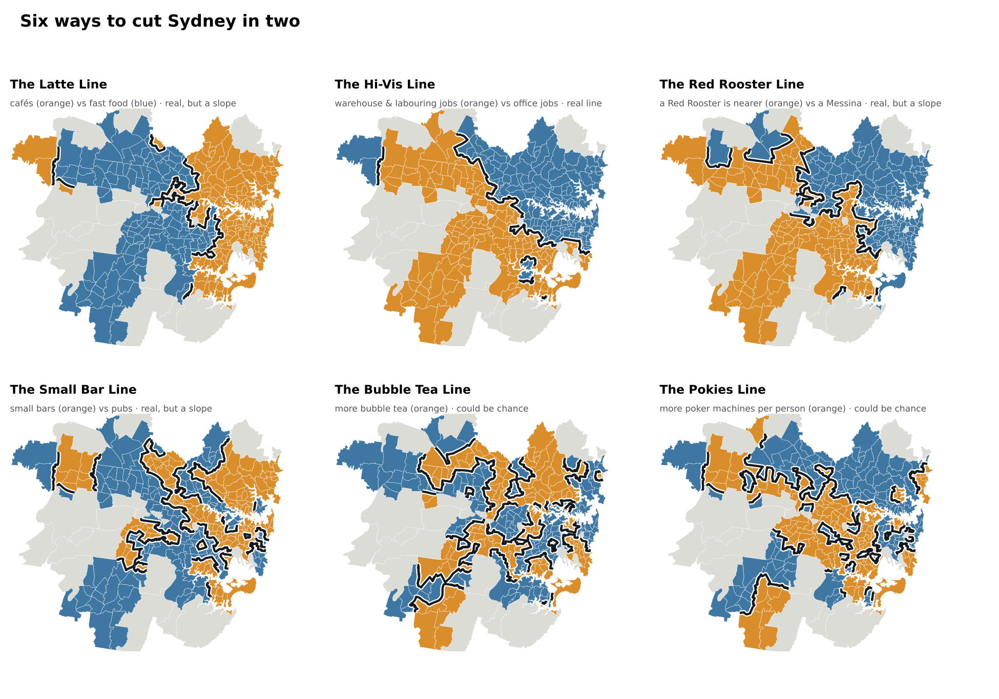

*Figure D1. Six ways to cut Sydney in two. The Hi-Vis Line is the one real line; the Latte, Red Rooster and Small Bar Lines are real patterns but slopes; bubble tea and pokies could be chance.*

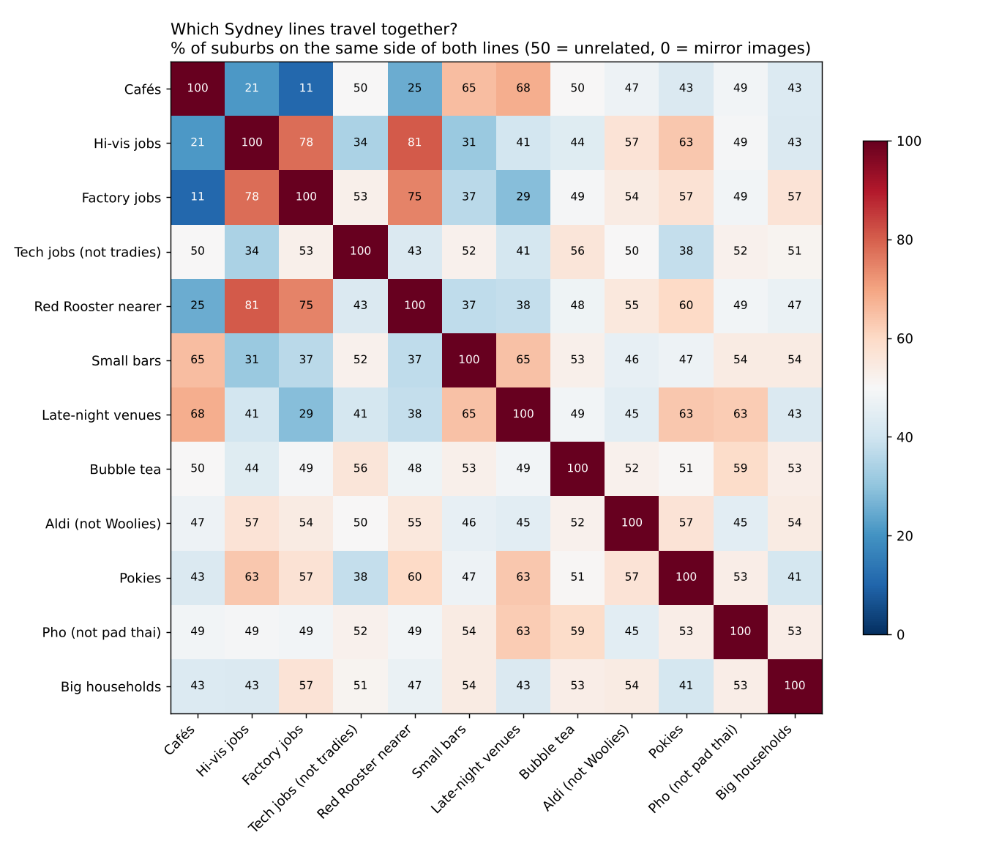

*Figure D2. Share of Sydney's 300 suburbs on the same side of two lines (50 = unrelated; Appendix C.2 explains why unrelated smooth maps still drift from 50). Cafés and factory jobs are near-mirror images (11%); Red Rooster and hi-vis jobs agree on 81%; bubble tea sits near 50 against every other line.*

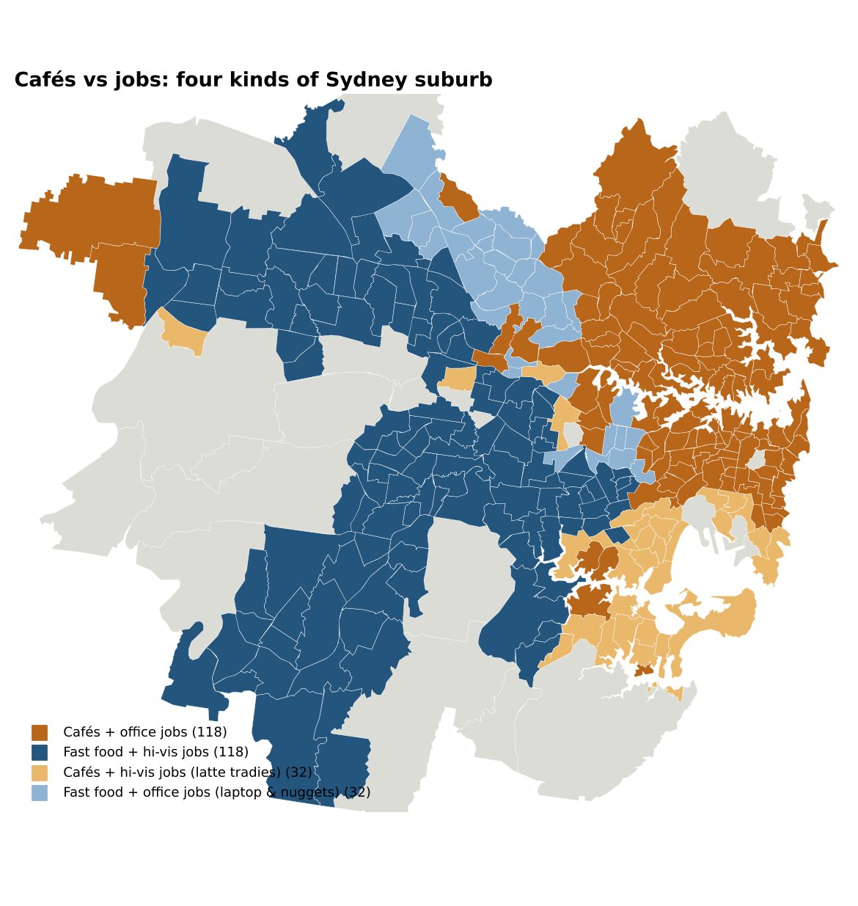

*Figure D3. Crossing the Latte Line with the Hi-Vis Line gives four kinds of suburb: 118 café-and-office, 118 fast-food-and-hi-vis, and 32 of each mixed kind. The mixed café-and-hi-vis suburbs cluster in the Sutherland Shire and around Botany Bay; the mixed fast-food-and-office suburbs cluster in the Hills and the inner west.*

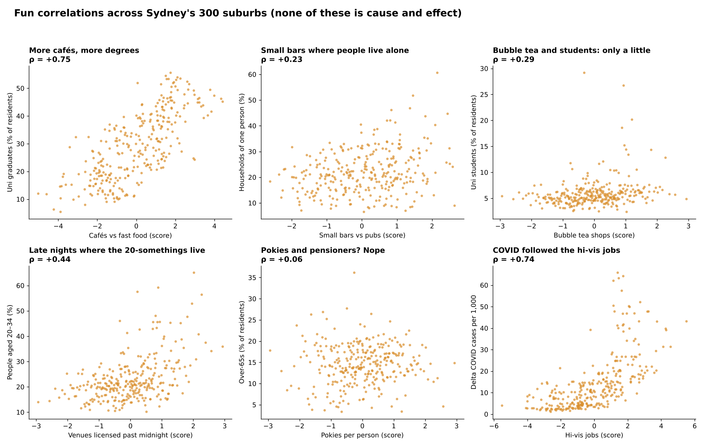

*Figure D4. Spearman correlations across Sydney's 300 suburbs: cafés and university graduates (ρ = 0.75), hi-vis jobs and Delta cases (0.74), late-night venues and residents aged 20–34 (0.44), bubble tea and university students (0.29), small bars and one-person households (0.23), pokies and residents over 65 (0.06). None of these is a test against random cities; they are descriptive.*

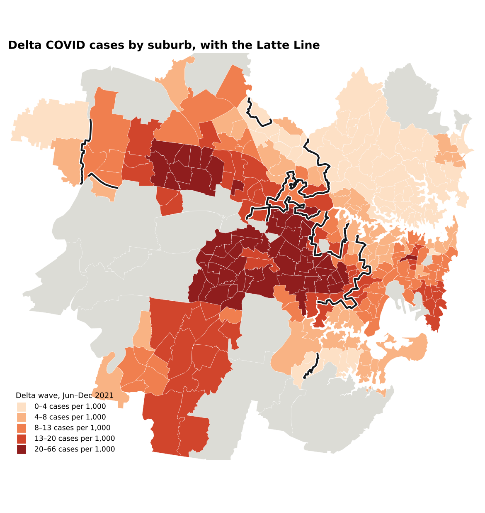

*Figure D5. Confirmed COVID-19 cases per 1,000 residents in the Delta wave (16 June to 15 December 2021), in five equal-count groups, with the Latte Line's border (Section 9.7).*

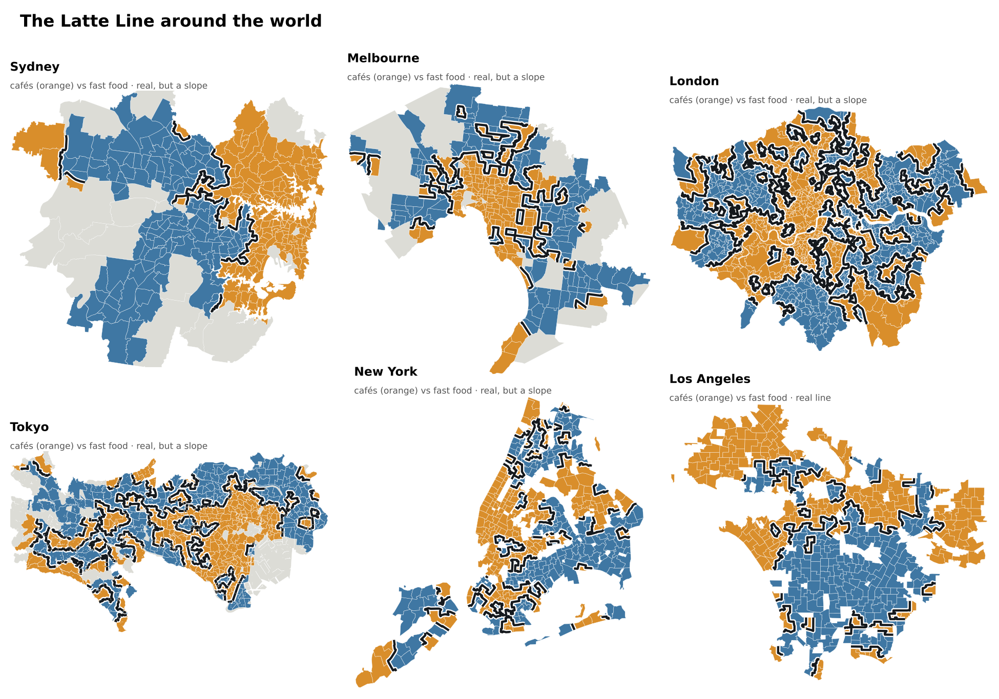

*Figure D6. The Latte Line in six cities. It is a real line in Los Angeles and a gentle slope in the other five.*

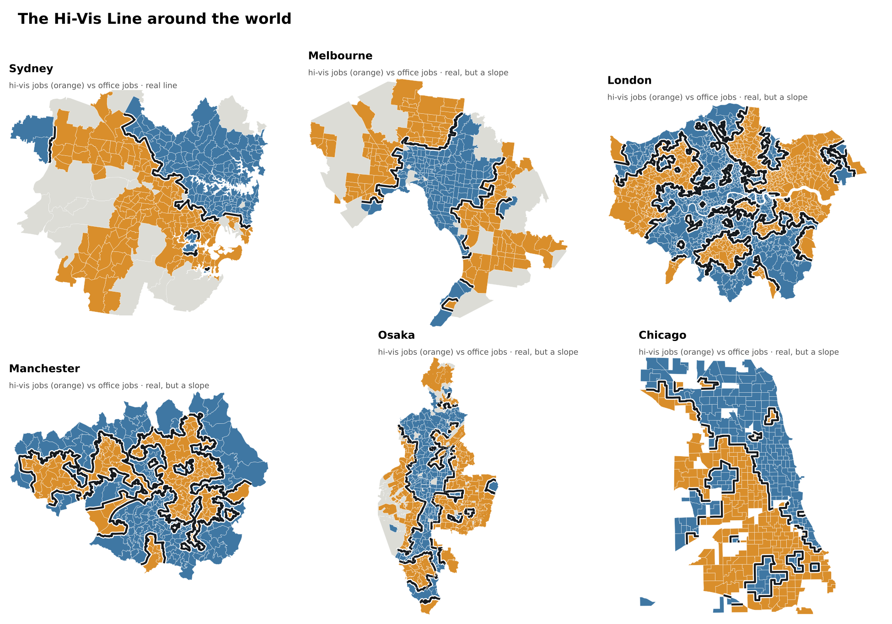

*Figure D7. The Hi-Vis Line in six cities. Of the 28 cities that have it, it is a real line only in Sydney and New York.*
