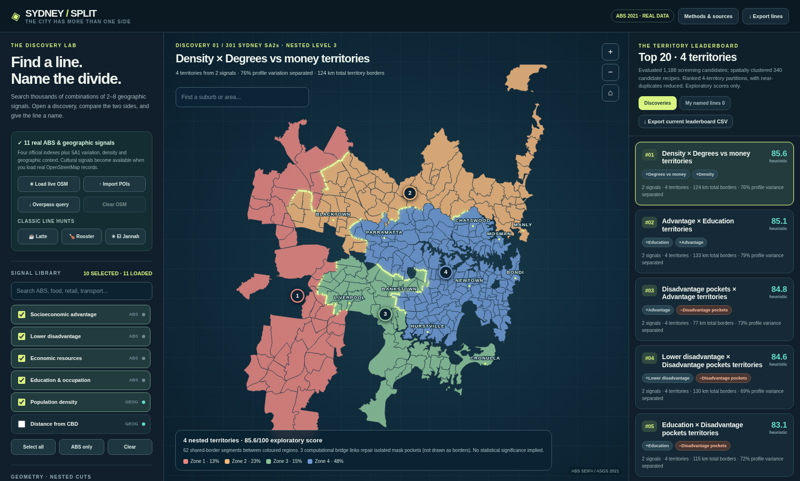

# Sydney / Split

**Explore the invisible boundaries of Sydney.** A real-data, browser-based geographic discovery prototype: combine 2–8 signals, rank candidate geographic divisions, explore nested 2–7-territory maps, inspect locations, and save your own names for promising boundaries.

**[Open the interactive atlas](https://pche123.github.io/Sydney-Split/)** (after GitHub Pages is enabled) · [Source](src/) · [Data provenance](docs/DATA.md) · [Methods](docs/METHODS.md) · [Research roadmap](docs/ROADMAP.md)



## Run it

Download **`index.html`** and open it in a modern desktop browser. No server, build tool, Python runtime, or account is required for the bundled ABS-only exploration. The standalone page embeds the real, derived 2021 ABS data and its geographic polygons.

For cultural venues, select **Load live OSM** (network and the community-operated Overpass endpoint must be available), or export the supplied Overpass query to an external editor and import its raw JSON. The app **does not bundle or simulate** Red Rooster, El Jannah or coffee-shop venue locations. The famous named lines are ideas to test, not observed discoveries until data is actually loaded and scrutinized.

This is a **research prototype, not a validated socio-policy indicator**. A leaderboard score is a descriptive heuristic, **not** a probability, p-value, explanation of causality, or measure of a neighbourhood's worth.

## What is in this snapshot?

| Component | State |
| --- | --- |
| 2021 ABS SEIFA and geography | Bundled real derived data, 301 selected SA2 regions and 650 shared-border edges |
| Four official SEIFA dimensions | IRSD, IRSAD, IER, IEO |
| Additional derived/geographic signals | SA1 within-SA2 spread, lower-quartile pockets, density, CBD distance, IEO–IER index gap |
| Combinations of 2–8 signals | Seeded signed-weight sampling and heuristic screening; no exhaustive search guarantee |
| Nested geographic partitions | One adjacency-constrained Ward-style hierarchy per candidate, cuts at 2–7 territories |
| Leaderboard, location detail, naming, exports | Available in browser |
| Red Rooster, cafe, El Jannah, other POIs | Requires independently loaded real OSM data; no preloaded venues |
| Statistical novelty/significance testing | **Not implemented** |
| Alternative boundary algorithms | **Not implemented** (see research roadmap) |

## Interpretation: colours, rankings, names

A *territory* is a set of adjacent statistical areas grouped by a geographic clustering algorithm. **Zone 1, Zone 2, etc. are identifiers within a candidate partition—not quality grades or Sydney socioeconomic rankings.** The app orders zones by their mean *signed recipe score*, which may combine positive and negative factors. Different recipes produce different notions of 'higher' and 'lower'. Do not compare zone IDs between discoveries. Likewise, the score is a heuristic computed using variance separated, border contrast, population balance and geographic simplicity, and is not calibrated across territory counts.

A real *line* should ideally name **one specific split within a hierarchy**, not every border surrounding K coloured territories. That important distinction and the need for plain-language explanations are next-stage design priorities.

## Source layout

- `index.html`: standalone public-facing app; ready for hosting once GitHub Pages is configured.
- `src/app.js`, `src/index.template.html`, `src/atlas-data.json`, `src/compile.py`: editable source and reproducible compile step.
- `data/`: compact, derived public ABS inputs; original large ABS downloads are not redistributed in this repo.
- `scripts/build_geography.py`, `scripts/build_derived.py`: documented regeneration steps from official ABS 2021 shapefile ZIPs and provided extracted SEIFA tables.
- `tests/test_integrity.py`: offline data/HTML integrity check.
- `docs/`: methods, coverage and methodological caveats, user-experience and research roadmap.
- `examples/`: a screenshot and historical two-region exploratory CSV, clearly not a validated scientific ranking.

## Rebuild

```bash
python -m pip install -r requirements.txt
python scripts/build_geography.py --sa2-shape /path/to/SA2_2021_AUST_SHP_GDA2020.zip
python scripts/build_derived.py --sa1-shape /path/to/SA1_2021_AUST_SHP_GDA2020.zip --sa2-shape /path/to/SA2_2021_AUST_SHP_GDA2020.zip
python src/compile.py
python tests/test_integrity.py
```

The included CSVs were derived from the user's original ABS SEIFA 2021 workbooks; row provenance is recorded in [DATA.md](docs/DATA.md). Regeneration has been smoke-tested for the existing artifacts, but byte-for-byte reruns with different GeoPandas/Shapely versions may change geometry order or simplification and must be checked.

## Data sources / attribution

- © Commonwealth of Australia (Australian Bureau of Statistics), **2021 Census SEIFA** and **Australian Statistical Geography Standard (ASGS) 2021**. Details and official links in [DATA.md](docs/DATA.md).
- When and only when venue points are loaded: **© OpenStreetMap contributors**, with attribution and licence conditions at https://www.openstreetmap.org/copyright. The live query is subject to external data availability and Overpass server policy.

**A note about labels:** Restaurant-chain names belong to their respective trademark owners; the project is independent and unaffiliated. A restaurant distribution is not evidence of the attributes or character of residents.

**License:** A software reuse license has not yet been selected by the repository owner. Do not assume permission to relicense or republish the code; the original ABS and OSM data have their respective terms.