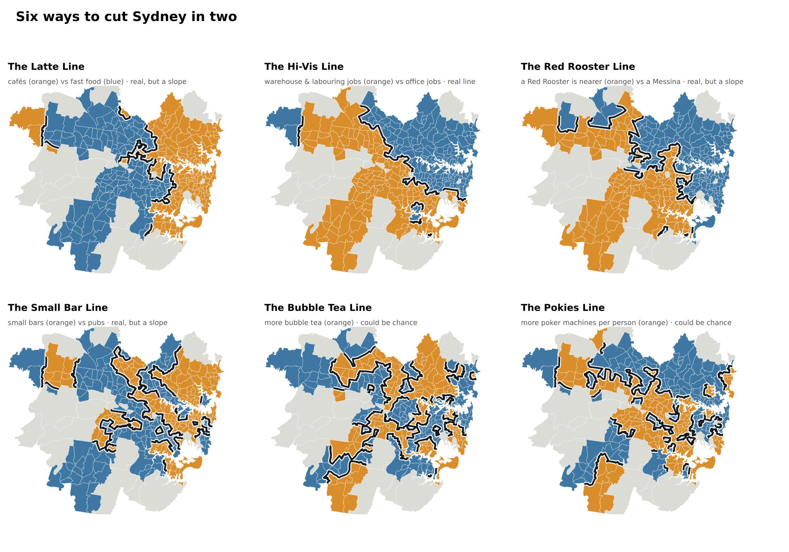
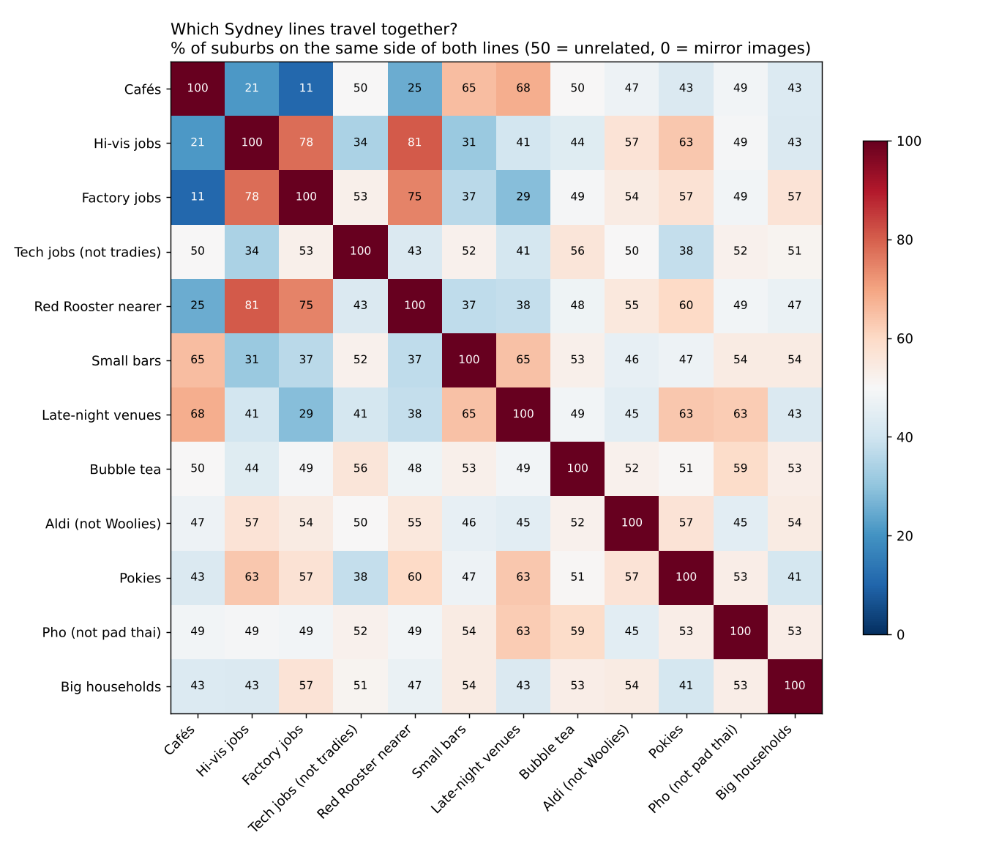
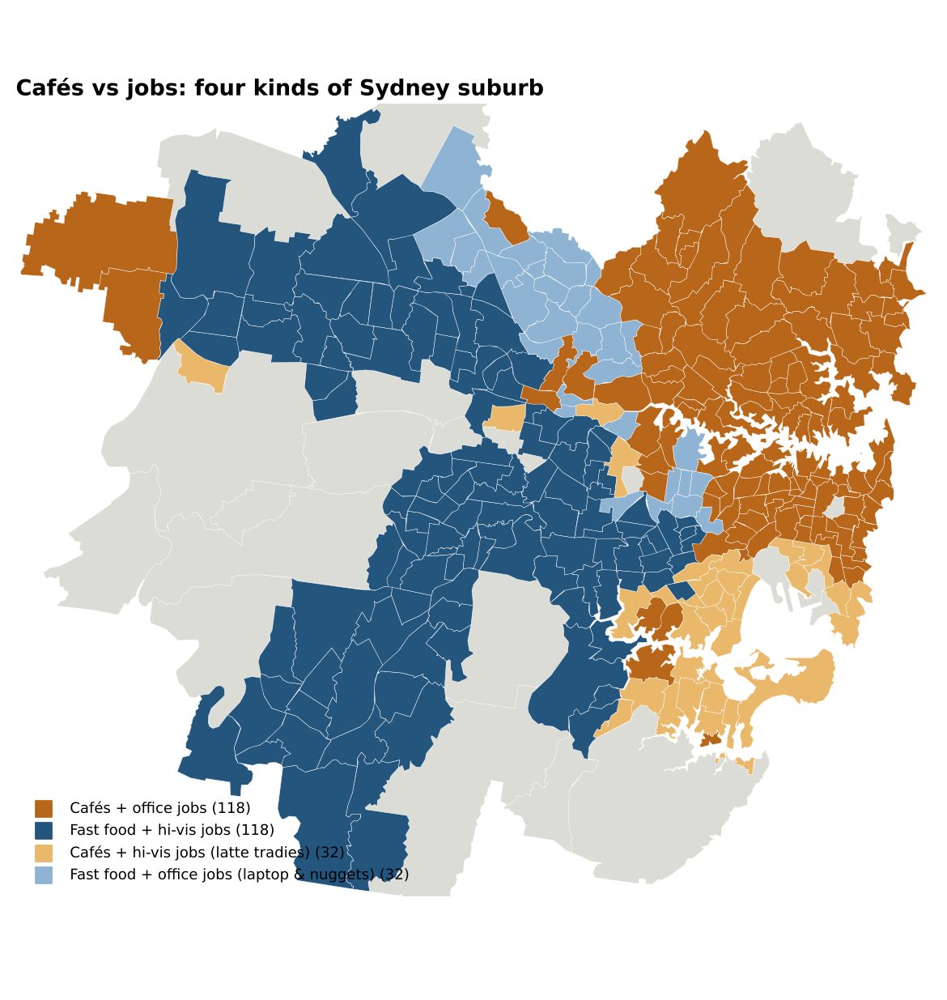
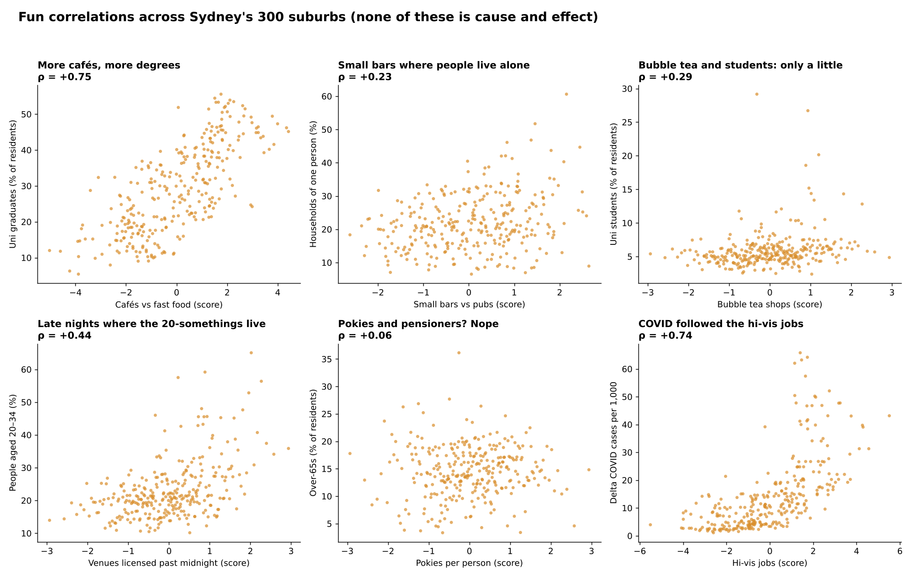
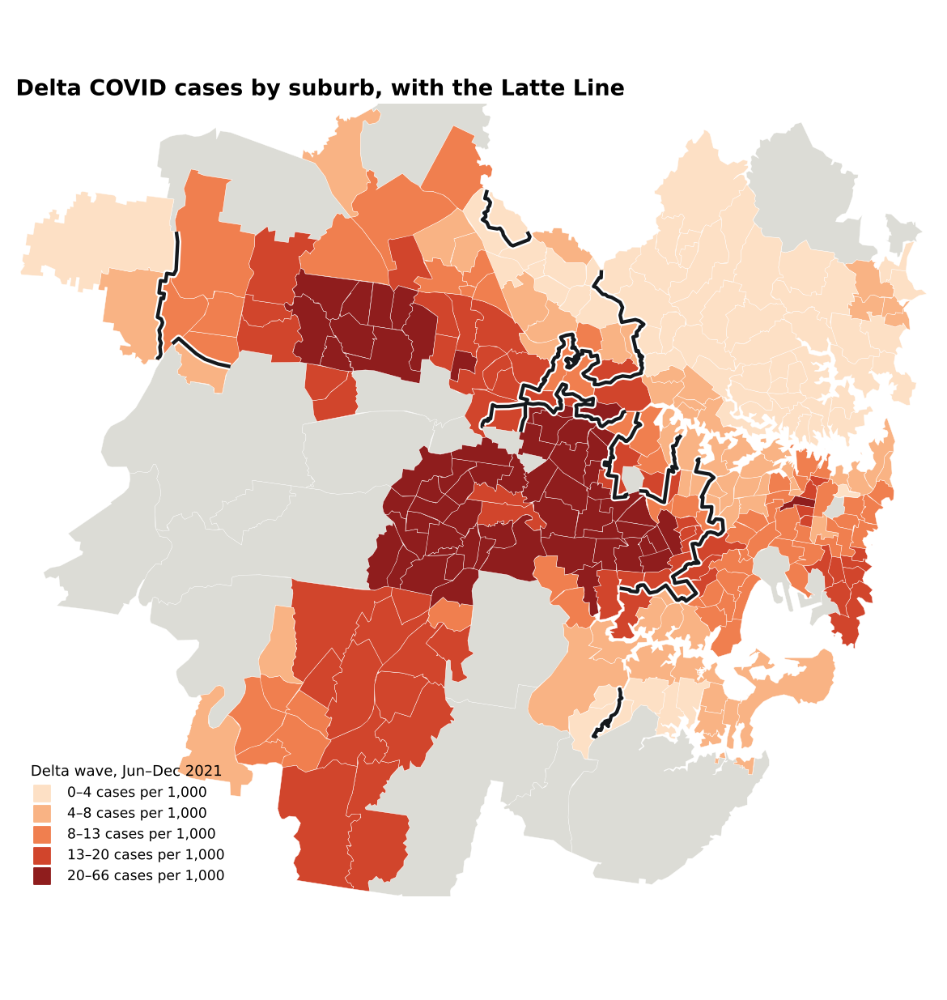
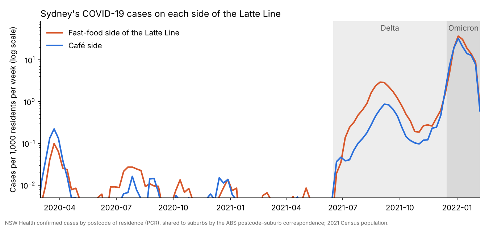
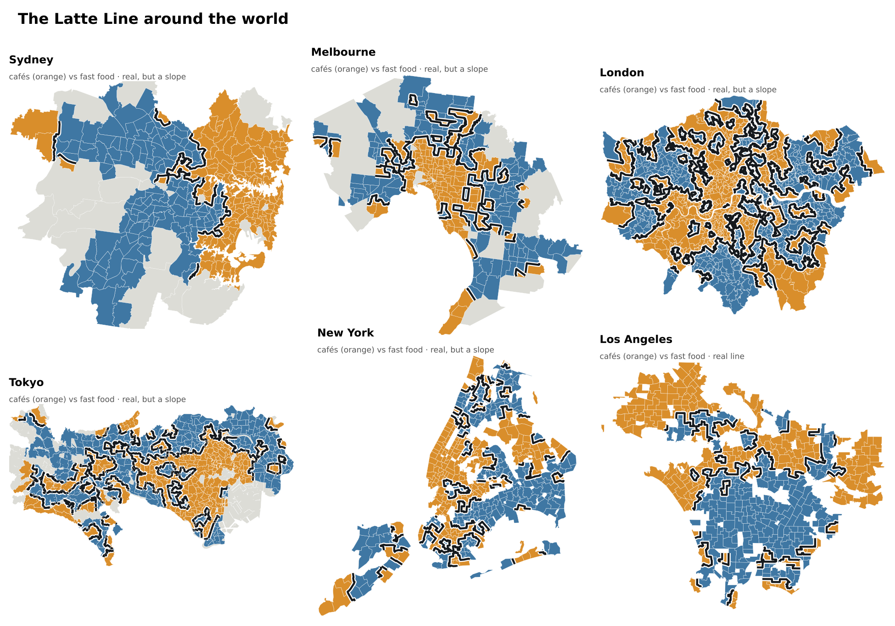
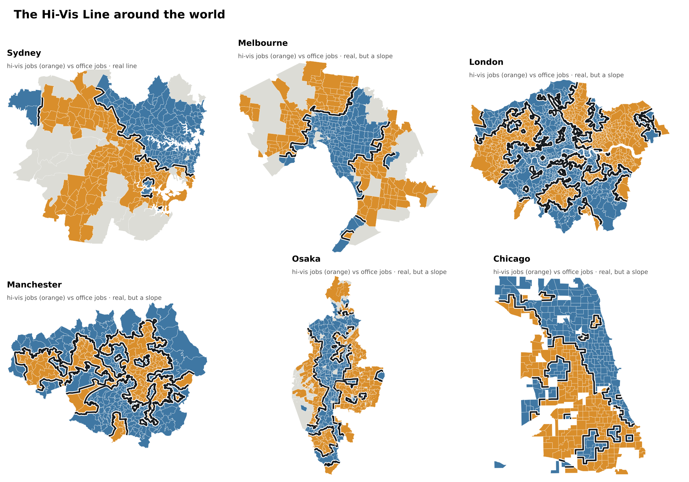
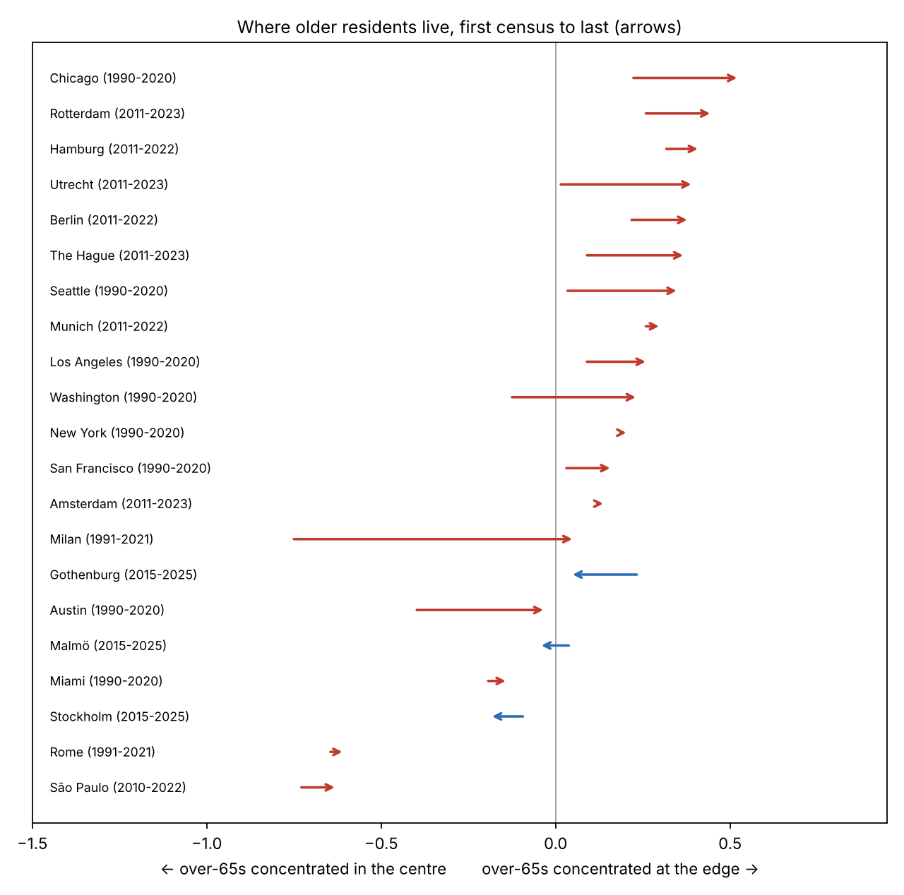
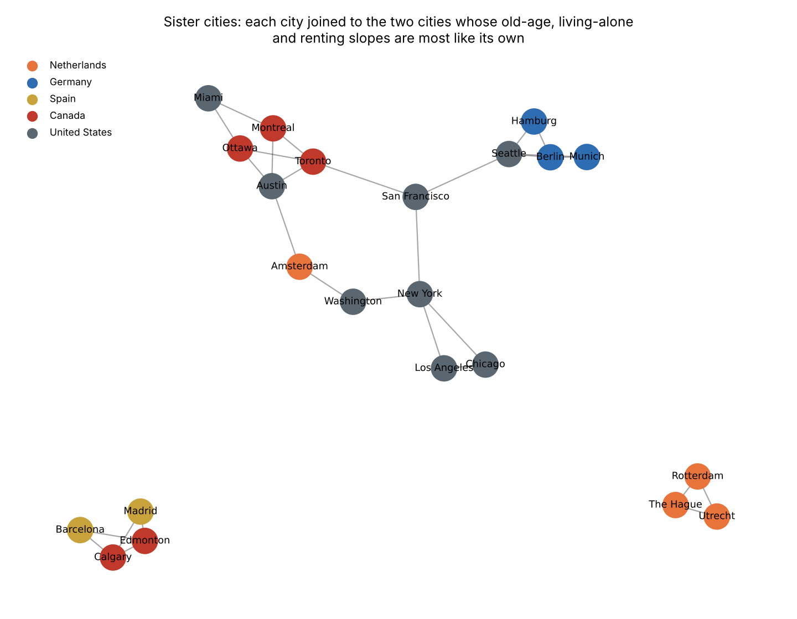

# Sydney Split: the invisible lines that divide cities

*Prasad Cheema · November 2026 · [interactive maps](https://pche123.github.io/Sydney-Split/) · [full research paper with proofs and background](PAPER.md)*

Sydney has a joke called the **Latte Line**: cafés to the north-east, fast food to the south-west. It ended up on Wikipedia. I wanted to know which of these "lines" are real, so I tested them properly. The test asks: if Sydney were random, but just as smooth as the real city, how often would it draw a border this clean? Then I took the same test to 41 cities in 12 countries.

Everything below describes **areas, not people**. A suburb being on one side of a line says nothing about anyone who lives there.

---

## Six ways to cut Sydney in two

Orange and blue are the two sides; the thick black line is the border. The verdicts:

- **The Hi-Vis Line** (warehouse, delivery and labouring jobs against office jobs) is the one **real line**: random Sydneys almost never draw a border that clean.
- **The Latte Line**, the **Red Rooster Line** and the **Small Bar Line** are **real patterns, but slopes**: Sydney fades from one side to the other over a few kilometres rather than snapping at a wall.
- **Bubble tea** and **pokies** **could be chance**: random Sydneys draw borders like those all the time.

## Which lines travel together?

Each square is the share of suburbs that land on the same side of two lines. 50 means the lines have nothing to do with each other.

- **Cafés and factory jobs are near-perfect opposites**: only 11% of suburbs are on the "same" side, so 89% sit on opposite sides (lots of cafés with few factory workers, or the reverse).
- **Red Rooster country is hi-vis country**: 81% of suburbs match.
- **Small bars go with cafés (65%) and late-night venues (65%)**: the night-out family.
- **Bubble tea goes with nothing**: it sits at about 50 against every other line. It is everywhere.

## Cafés against jobs: four kinds of suburb

Most suburbs are on the "matching" sides: 118 are café-and-office, 118 are fast-food-and-hi-vis. The fun ones are the 64 that break the pattern:

- **Latte tradies** (cafés, but hi-vis jobs), 32 suburbs, mostly the Sutherland Shire and the St George and Botany Bay area: Cronulla, Miranda, Sutherland, Kogarah, Rockdale, Hurstville, Mascot, Botany, Matraville and more.
- **Laptop & nuggets** (office jobs, but fast food), 32 suburbs, mostly the Hills and the inner west: Castle Hill, Baulkham Hills, Kellyville, Rouse Hill, Carlingford, Parramatta, Strathfield, Burwood and Concord.

## Fun correlations

ρ (Spearman's rho) runs from −1 to +1; 0 means no relationship. None of these is cause and effect: cafés don't give anyone a degree.

| What we compared | ρ | Verdict |
|---|---|---|
| Cafés and university graduates | +0.75 | Strong: café suburbs are graduate suburbs |
| Hi-vis jobs and Delta COVID cases | +0.74 | Strong (see below) |
| Late-night venues and people aged 20–34 | +0.44 | Clear |
| Bubble tea and uni students | +0.29 | Only a little |
| Small bars and people living alone | +0.23 | Weak |
| Pokies and over-65s | +0.06 | Nope: the pokies-and-pensioners stereotype isn't in the data |

## COVID-19: where the Delta cases fell

In 2021 twelve councils got the strictest lockdown rules, and they lay mostly on the fast-food side of the Latte Line. I wrote down a test before downloading NSW Health's case data, asking where the cases themselves fell.

- **During Delta (mid-June to mid-December 2021), cases were three times as common on the fast-food side**: about 22 per 1,000 residents (1 in 45) against 7 per 1,000 (1 in 137). Three in four of Sydney's Delta cases were on that side.
- **Not chance**: the real line matched the cases more closely than 997 of 999 random Sydneys.
- **It was about jobs, not coffee**: among suburbs with the same mix of jobs, cafés told us nothing more about COVID. The Latte Line mattered because it follows where work couldn't be done from home.
- **It wasn't always this way**: in 2020 the café side had more cases (returning travellers), and when Omicron spread everywhere the gap nearly closed.

These are confirmed cases by home postcode, so testing plays a part, and they show where the cases fell, not why or whether any rule was fair.

## The Latte Line around the world

Cafés and fast food sort apart in all 29 cities of the first round. It's a **real line in Los Angeles** (and in Brisbane, Fukuoka and San Francisco) and a gentle slope in Sydney, Melbourne, London, Tokyo and New York. In Europe it holds in **Barcelona, Marseille and Rome** (less clearly Paris), but **not in Amsterdam, Stockholm, Copenhagen** or the other Dutch, Swedish and Danish cities. In Canada only Ottawa shows it.

## The Hi-Vis Line around the world

The jobs divide shows up everywhere, but only in Sydney and New York is it sharp enough to count as a real line.

## Meme lines from other countries

All written down before looking, so no cherry-picking:

- **The Poutine Line is real.** Across the Ottawa River, about 1 in 13 fast-food places in Gatineau (Quebec) sells poutine; in Ottawa (Ontario) about 1 in 75.
- **Paris's Croissant Line and Hamburg's Bread Line are real**: bakeries give way to fast food in Paris, and independent bakers give way to chains in Hamburg.
- **No line**: São Paulo's *Coffee vs Churrasco*, Amsterdam's *Snackbar vs Koffiebar*, Sweden's *Fika Line* and England's *Chippy Line*. (Birmingham has the most chippies per café: about 2 for every 5.)

## Older people are moving to the suburbs

In 18 of 21 cities with census data over time (the US since 1990, Italy since 1991, Germany, the Netherlands, Sweden and São Paulo), over-65s have shifted from the centre towards the edge. People who bought suburban houses decades ago have grown old in them. Where people rent or live alone has barely moved: those follow the buildings.

## Do cities have a grammar? No, and that's a result

Give every suburb a four-letter "word": which side it sits on for work, inner city, age and nightlife. Do neighbouring suburbs' words follow rules, like a language? Against random cities that copy each line on its own, 19 of 26 cities seem to have a grammar. But once the random cities also keep the big gradients the lines share (the inner city is the same inner city for every line), only 1 of 26 does (Auckland), about what chance alone would give. The "grammar" was one big map underneath, read four ways.

The same goes for rules like "where over-65s are few and houses are few, people walk to work". Most such rules follow from the correlation table alone. About 12% beat that, against 5% by chance, and they travel badly between countries (Australian rules hold in only 23% of English cases and 32% of Japanese ones).

Why it matters: any AI or "symbolic" model that claims to learn the rules of cities has to beat this baseline first. Ours shows how easy it is to be fooled.

## Sister cities

Give every city a fingerprint (how age, living alone and renting change from centre to edge) and a city's closest sister is in its own country 59% of the time, far more than chance (p = 0.001). Each country's housing leaves its mark. The surprises: Amsterdam's sister is Washington, Hamburg's is Seattle, Madrid's is Calgary, and Seoul's (on the two measures Korea has) is Ottawa.

On the [interactive maps](https://pche123.github.io/Sydney-Split/), tap any suburb to find its **twin suburbs abroad**: Surry Hills' twins include Tenjin in Fukuoka and Barons Court in London.

---

*Data: ABS Census 2021 and earlier, OpenStreetMap, NSW Health, NSW Liquor & Gaming, and national statistics offices of 12 countries. Methods, every number and the code: [the full paper](PAPER.md) and [GitHub](https://github.com/pche123/Sydney-Split).*
